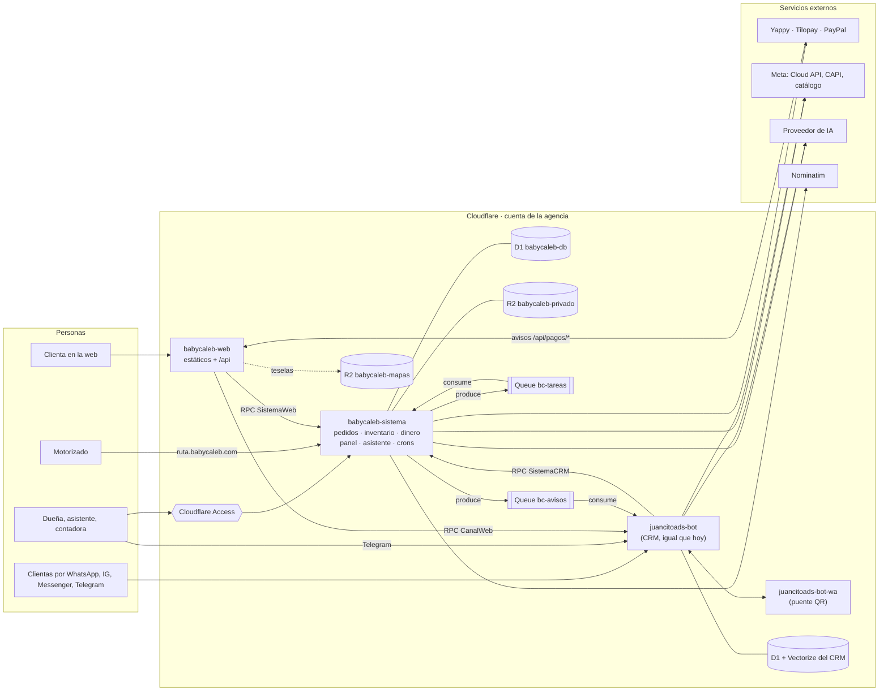
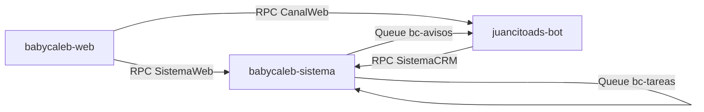
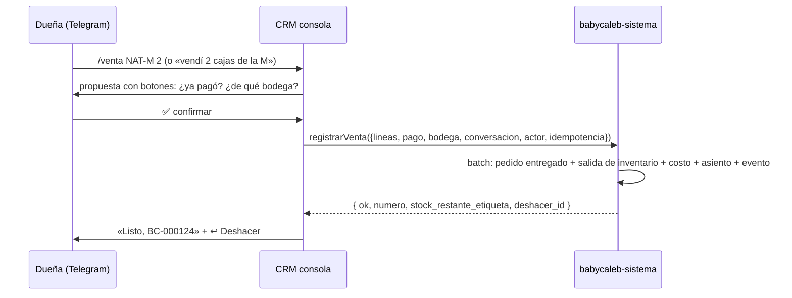
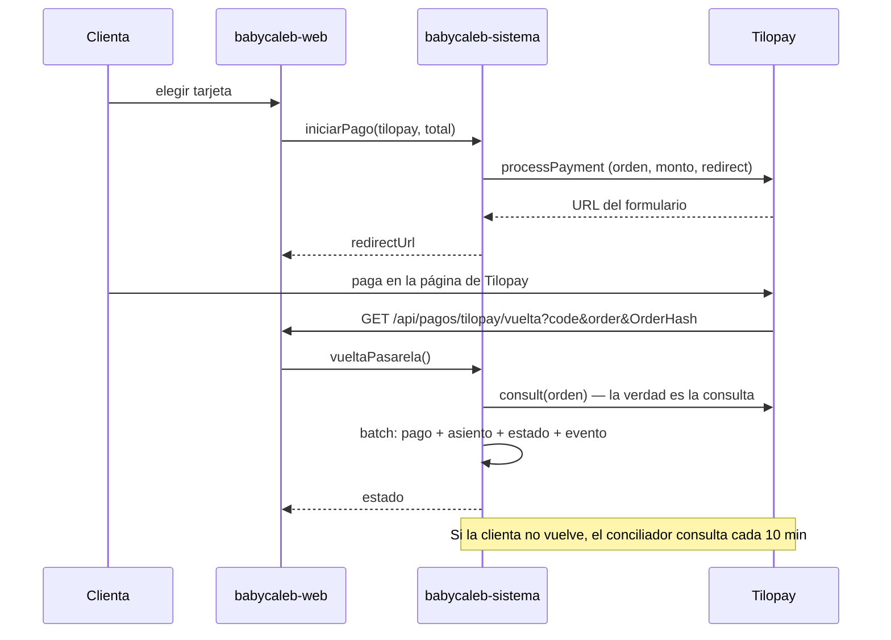
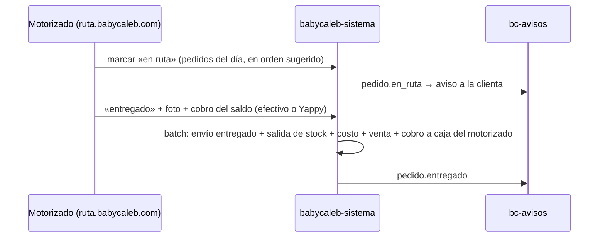

# 01 · Arquitectura

## 1. Vista general



Tres Workers propios y el puente que ya existe. Ninguno queda encendido todo el día: solo el
contenedor del puente de WhatsApp, que ya existe hoy.

## 2. Piezas y recursos

### Workers

| Worker | Repo y carpeta | Qué hace | Plan de despliegue |
|---|---|---|---|
| `babycaleb-web` | `Baby-caleb/` (raíz) + `worker/` | Sirve la web estática; reescribe el `<head>` por ruta; expone `/api/*` público y lo pasa al sistema o al CRM | `.github/workflows/web.yml` |
| `babycaleb-sistema` | `Baby-caleb/sistema/` | API de pedidos, pagos, inventario, entregas, contabilidad; panel; app del motorizado; asistente; crons | `.github/workflows/sistema.yml` |
| `juancitoads-bot` | `CRM-Baby-Caleb/` | El bot de atención y la consola de la dueña. Gana un canal web, un consumidor de cola y un cliente del sistema | Su `deploy.yml` actual |
| `juancitoads-bot-wa` | `CRM-Baby-Caleb/puente-wa/` | WhatsApp por QR. Sin cambios | Su `puente-wa.yml` actual |

Staging: `babycaleb-web-staging` y `babycaleb-sistema-staging`, con sus propios recursos. Nunca
comparten D1 ni R2 con producción.

### Recursos de Cloudflare

| Recurso | Nombre (producción / staging) | Uso |
|---|---|---|
| D1 | `babycaleb-db` / `babycaleb-db-staging` | Toda la verdad del negocio (ver [02-datos](02-datos.md)) |
| R2 privado | `babycaleb-privado` / `babycaleb-privado-staging` | Comprobantes, fotos de entrega, recibos, adjuntos del asistente. Sin dominio público |
| R2 respaldos | `babycaleb-respaldos` | Exportaciones diarias cifradas de D1. Solo lo escribe CI |
| R2 mapas | `babycaleb-mapas` (público en `mapas.babycaleb.com`) | Teselas de Panamá en formato PMTiles |
| Queue | `bc-avisos` + DLQ `bc-avisos-muertos` | Del sistema al CRM: avisos a clientas y a la dueña |
| Queue | `bc-tareas` + DLQ `bc-tareas-muertos` | Del sistema a sí mismo: Meta CAPI, correos, reintentos, trabajo pesado |
| Rate limiting | namespaces `1001`…`1004` | Frenar abuso en checkout, chat web, códigos y geocodificación |
| Turnstile | widget `babycaleb.com` | Proteger «Hacer mi pedido» y «Mi cuenta» |
| Access | apps `panel.babycaleb.com` y staging | Puerta del equipo |
| Email Routing | `babycaleb.com` | `hola@` y lo demás al Gmail del negocio |
| Web Analytics | `babycaleb.com` | Visitas sin cookies |

El plan Workers Paid ya está contratado en la cuenta (lo exige el contenedor del puente).

## 3. Dominios y rutas

| Hostname | Va a | Puerta |
|---|---|---|
| `babycaleb.com` | `babycaleb-web` (dominio propio del Worker) | Pública |
| `www.babycaleb.com` | Redirección 301 a `babycaleb.com` (regla de redirección) | Pública |
| `panel.babycaleb.com` | `babycaleb-sistema` | Access + validación del JWT en el Worker |
| `ruta.babycaleb.com` | `babycaleb-sistema` | Celular + PIN del motorizado |
| `mapas.babycaleb.com` | R2 `babycaleb-mapas` | Pública, solo lectura |

`babycaleb-sistema` lleva `workers_dev = false` y `preview_urls = false` en producción. En staging
usa workers.dev protegido por Access.

### Rutas de `babycaleb-web`

`wrangler.jsonc` de la web:

```jsonc
{
  "name": "babycaleb-web",
  "main": "worker/index.ts",
  "compatibility_date": "2026-10-01",
  "compatibility_flags": ["nodejs_compat"],
  "assets": {
    "directory": "./dist",
    "binding": "ASSETS",
    "not_found_handling": "single-page-application",
    // El Worker corre primero solo donde hace falta; el resto sale directo de los estáticos.
    "run_worker_first": ["/api/*", "/", "/productos", "/productos/*", "/beneficios", "/historia",
                         "/tips", "/como-comprar", "/faq", "/seguimiento/*"]
  },
  "services": [
    { "binding": "SISTEMA", "service": "babycaleb-sistema", "entrypoint": "SistemaWeb" },
    { "binding": "CRM", "service": "juancitoads-bot", "entrypoint": "CanalWeb" }
  ],
  "observability": { "enabled": true }
}
```

| Ruta | Método | Qué hace |
|---|---|---|
| `/`, `/productos`, `/productos/:slug`, `/beneficios`, `/historia`, `/tips`, `/como-comprar`, `/faq` | GET | Sirve `index.html` y reescribe el `<head>` con `HTMLRewriter`: título, descripción, canónico, Open Graph, JSON-LD (`Organization`, `Product` con `offers.price` del sistema, `FAQPage`) |
| `/seguimiento/:token` | GET | Igual, con `noindex` |
| `/mi-cuenta/*`, `/carrito`, `/pedido/*` | GET | SPA directa desde estáticos, `noindex` en el HTML base de esas rutas |
| `/api/catalogo` | GET | `SISTEMA.catalogo()` con caché en el borde de 60 s |
| `/api/envio/zonas` | GET | Zonas y tarifas públicas |
| `/api/pedidos` | POST | Turnstile + límite + `SISTEMA.crearPedido()` |
| `/api/pedidos/:token` | GET | Estado público del pedido |
| `/api/pedidos/:token/pago` | POST | `SISTEMA.iniciarPago()` |
| `/api/pagos/:proveedor/aviso` | POST | Webhook de la pasarela → `SISTEMA.avisoPasarela()` (cuerpo crudo) |
| `/api/pagos/:proveedor/vuelta` | GET | Vuelta del navegador → `SISTEMA.vueltaPasarela()` y redirección a `/pedido/:token` |
| `/api/geo/buscar`, `/api/geo/inverso` | GET | Geocodificación con caché |
| `/api/chat` | POST | Límite + `CRM.mensajeWeb()` |
| `/api/cuenta/*` | POST | Código o PIN, sesión de la clienta |
| `/api/salud` | GET | Versión de la web y salud de los dos bindings |

Las cabeceras de seguridad de los estáticos van en `public/_headers`; las del HTML reescrito y de
`/api/*` se ponen en el código, porque `_headers` no se aplica a respuestas del Worker.

### Rutas de `babycaleb-sistema`

| Hostname · ruta | Qué hace |
|---|---|
| `panel` · `/` y rutas del SPA | Panel (React + Vite) servido desde `sistema/panel/dist` |
| `panel` · `/api/*` | API del panel (Hono), con el usuario sacado del JWT de Access |
| `panel` · `/api/asistente/stream` | Chat del asistente con eventos enviados por el servidor (SSE) |
| `panel` · `/mcp` | Servidor MCP del asistente (excluido de Access, con su propia autenticación; ver [06](06-asistente.md)) |
| `panel` · `/salud` | Versión, migración y prueba de humo |
| `ruta` · `/` y `/api/*` | App del motorizado (mismo SPA, vista reducida) |
| entrypoint `SistemaWeb` | RPC para la web |
| entrypoint `SistemaCRM` | RPC para el CRM |
| `queue()` | Consumidor de `bc-tareas` |
| `scheduled()` | Crons (ver [08 §6](08-operacion.md#6-crons)) |

## 4. Los cables entre piezas



- **RPC por service binding** (`WorkerEntrypoint` con entrypoints con nombre). No sale a internet,
  no cuesta aparte y cada lado solo ve los métodos de su entrypoint. Un pedido puede encadenar como
  máximo 32 invocaciones de Workers: el diseño usa 2 o 3.
- **Colas** para todo lo que va del sistema al CRM y para el trabajo que no debe frenar una
  respuesta. Entrega al menos una vez: cada consumidor guarda el `id` del evento y no lo repite.
- **Sin bindings circulares.** El CRM tiene binding al sistema; el sistema no tiene binding al CRM.
  Orden de despliegue: sistema primero, después CRM.
- **Patrón outbox.** Todo cambio de estado escribe su evento en `eventos_salida` dentro del mismo
  `batch`. Después del batch se publica a la cola; un cron cada 5 minutos republica lo que haya
  quedado sin publicar. Ningún evento se pierde aunque la cola falle en ese instante.
- **Errores por RPC.** Una excepción que cruza un binding llega sin su tipo. Los métodos devuelven
  `{ ok: true, ... } | { ok: false, codigo, mensaje }` y nunca lanzan errores de negocio (ver
  [03 §5](03-contratos.md#5-idempotencia-y-errores)).

## 5. Tecnología

| Capa | Elección | Por qué |
|---|---|---|
| Lenguaje | TypeScript estricto | El de los tres repos |
| HTTP | Hono | El del CRM; corre nativo en Workers |
| Validación | zod | Esquemas compartidos con el CRM y JSON Schema para el asistente |
| Base | D1 (SQLite) | Incluida en el plan; Time Travel de 30 días |
| Archivos | R2 | Sin costo de salida; 10 GB incluidos |
| Panel | React 19 + Vite + Tailwind 4 | El stack de la web: reusa tokens y criterio visual |
| Pruebas | Vitest + `@cloudflare/vitest-pool-workers` | D1, colas y bindings reales en local |
| E2E | Playwright (ya instalado en estas sesiones) | Web, checkout y comparación de píxeles |
| IA | Meta Muse Spark Contributor por su puerta compatible con Anthropic (`api.meta.ai/v1`), detrás de una capa de proveedor intercambiable | Decisión D-19; patrón de `CRM-Baby-Caleb/src/llm/provider.ts` y `dcasa_brian/models/proveedores.py` |
| Node / wrangler | Node 22, wrangler 4.x (≥ 4.36 por el binding de rate limiting) | — |

Durable Objects no hacen falta en el sistema: la concurrencia la resuelven las restricciones de D1
y la idempotencia. Si un día hiciera falta un límite estricto global, se agrega uno.

## 6. Mapa y direcciones

- **Teselas:** Protomaps (archivo PMTiles de Panamá) en el R2 `babycaleb-mapas`, servido por
  `mapas.babycaleb.com` con solicitudes por rango. Sin cuota mensual. El visor es `maplibre-gl`,
  el mismo de Nébula (`apps/storefront/package.json`).
- **Búsqueda de direcciones:** Nominatim a través de `/api/geo/*`, como
  `tommalopty/apps/storefront/src/app/api/geo/buscar/route.ts`: una sola salida identificada, caché
  en el borde y límite de ritmo.
- **Zonas y tarifa:** el tarifario de Baby Caleb es por nombre de zona
  (`CRM-Baby-Caleb/member/zonas-envio.ts`), no por polígono. La clienta elige la zona de una lista
  con búsqueda por alias; el pin es para el motorizado. Si en el futuro se dibujan polígonos, la
  función `findZoneForPoint` de Nébula ya existe.
- **Precisión del punto:** `gps`, `pin`, `geocodificado` o `manual` (`LOCATION_PRECISIONS` de
  Nébula). La guía del motorizado dice cuál es.

## 7. Estructura del repositorio

```
Baby-caleb/
├── src/ public/ content.json index.html vite.config.ts   ← la web, igual que hoy
├── worker/                    ← Worker de la web
│   ├── index.ts               ← enrutador: estáticos, HTML reescrito, /api/*
│   ├── head.ts                ← HTMLRewriter por ruta
│   ├── api.ts                 ← proxy a SISTEMA y CRM, Turnstile, límites
│   └── tsconfig.json
├── wrangler.jsonc             ← babycaleb-web
├── sistema/
│   ├── package.json  package-lock.json  tsconfig.json  wrangler.jsonc  vitest.config.ts
│   ├── migrations/            ← 0001_base.sql, 0002_…  (wrangler d1 migrations)
│   ├── reglas.json            ← valores de fábrica con PENDIENTE donde falta el dato
│   ├── src/
│   │   ├── index.ts           ← fetch, queue, scheduled; exporta SistemaWeb y SistemaCRM
│   │   ├── dominio/           ← funciones puras (dinero, stock, pedidos, envíos, abonos, rutas)
│   │   ├── db/                ← repositorios por tabla
│   │   ├── pedidos/ pagos/ envios/ inventario/ contabilidad/ clientes/
│   │   ├── asistente/         ← registro, política, herramientas/, proveedor de IA
│   │   ├── seguridad/         ← access.ts, pin.ts, sesion.ts, turnstile.ts
│   │   ├── eventos/           ← outbox, publicador, consumidor de bc-tareas
│   │   ├── contrato/          ← esquemas zod compartidos con el CRM + huella
│   │   └── api/               ← rutas del panel y de la ruta del motorizado
│   ├── panel/                 ← React + Vite → panel/dist
│   └── test/
├── docs/
│   ├── plan/                  ← este plan
│   ├── LEEME_PRIMERO.md  PRIORIDADES.md  CONTEXTO_AGENTICO.md  FUENTES_DE_VERDAD.md
│   └── CONTRATO_CRM.md
├── .github/workflows/  web.yml  sistema.yml  respaldo.yml
└── 📤SUBIR-CONTENIDO/        ← no se mueve
```

`sistema/` tiene su propio `package.json` y lockfile (como `edge/` y `juan/` en D'Casa), para que
nada de su desarrollo cambie el build de la web.

## 8. Secuencias principales

### Compra en la web con Yappy

```mermaid
sequenceDiagram
  participant C as Clienta
  participant W as babycaleb-web
  participant S as babycaleb-sistema
  participant Y as Yappy
  participant Q as bc-avisos
  participant R as CRM
  C->>W: POST /api/pedidos (carrito, zona, datos, Turnstile)
  W->>S: crearPedido(input, idempotencia)
  S->>S: batch: pedido + líneas + reservas + evento (CHECK de stock)
  S-->>W: { numero, token, total, vence_en }
  C->>W: POST /api/pedidos/:token/pago (yappy, abono o total)
  W->>S: iniciarPago()
  S->>Y: crear orden de pago
  S-->>W: datos del botón
  C->>Y: paga en la app de Yappy
  Y->>W: POST /api/pagos/yappy/aviso
  W->>S: avisoPasarela(cuerpo crudo, cabeceras)
  S->>S: verifica firma, evento único, monto = esperado; batch: pago + asiento + estado + evento
  S->>Q: pago.confirmado
  Q->>R: aviso a la clienta (plantilla) y a la dueña (Telegram)
```

### Venta registrada por la dueña en Telegram



### Pago con Tilopay



### Entrega con cobro del saldo


