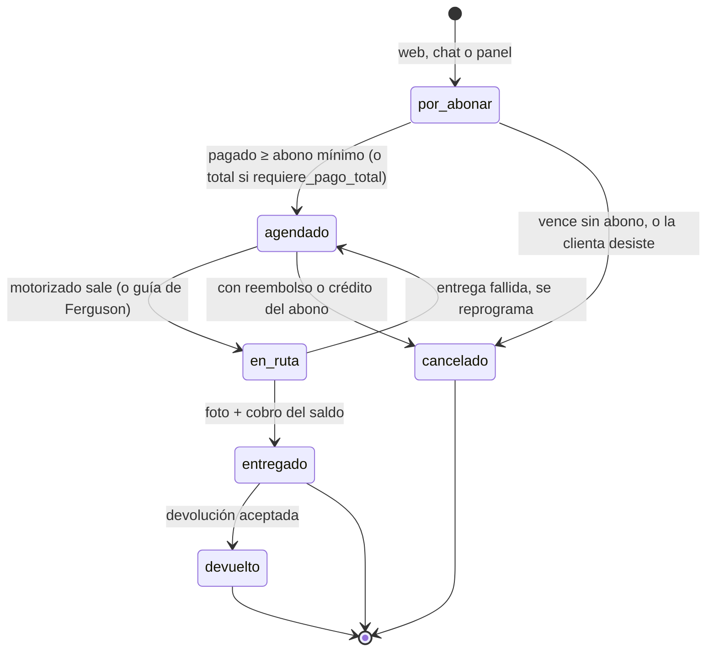

# 02 · Modelo de datos (D1 `babycaleb-db`)

Esquema de partida para la migración `0001_base.sql` y las siguientes. Es SQLite de D1: se escribe
como migraciones versionadas (`wrangler d1 migrations create/apply`), nunca reaplicando un archivo
entero como hace el CRM con `schema.sql`.

## 1. Convenciones

| Tema | Regla |
|---|---|
| Identificadores | `TEXT` con ULID (ordenables por tiempo). Los códigos de producto son la llave natural de `variantes` |
| Dinero | `INTEGER` en centavos de USD (`*_cents`), como `catalog_items` del CRM. Nunca `REAL` |
| Tiempo | `INTEGER` en milisegundos UTC (`*_en`). Las fechas contables son `TEXT 'YYYY-MM-DD'` en hora de Panamá (UTC−5, sin horario de verano) |
| Booleanos | `INTEGER` 0/1 con `CHECK (x IN (0,1))` |
| Tablas | `STRICT` (tipos verificados). La migración 0001 trae una prueba que lo confirma en D1 |
| Llaves foráneas | D1 las hace cumplir por defecto. Las migraciones que recrean tablas usan `PRAGMA defer_foreign_keys = on` |
| Libros | Tablas de movimientos con triggers que abortan `UPDATE` y `DELETE`: se corrige con un movimiento contrario (`revierte_id`) |
| Concurrencia | Restricciones `CHECK` + `db.batch()` atómico + filas de control (abajo). No hay transacciones interactivas en D1 |
| Nombres | En español, `snake_case`. `compras_proveedor`, no `compras` (ese nombre ya lo usa el CRM para otra cosa) |
| Orden | Este documento va por tema; la migración crea las tablas en orden de dependencias (por ejemplo `zonas_envio` antes que `direcciones`, `pedidos` antes que `reservas`) |

### Filas de control: cómo se garantiza algo sin transacciones interactivas

`db.batch()` corre en orden y es todo o nada, pero un `UPDATE ... WHERE estado = 'x'` que no
encuentra la fila no falla: cambia cero filas y el batch sigue. Para que una condición tumbe el
batch se inserta, después del cambio, una fila de control cuya restricción solo se cumple si el
cambio ocurrió:

```sql
CREATE TABLE controles (
  id        TEXT PRIMARY KEY,
  regla     TEXT NOT NULL,
  ok        INTEGER NOT NULL CHECK (ok = 1),
  creado_en INTEGER NOT NULL
) STRICT;

-- Ejemplo dentro de un batch: pasar un pedido de por_abonar a agendado sin pisar a otro proceso
UPDATE pedidos SET estado = 'agendado', version = version + 1, actualizado_en = ?3
 WHERE id = ?1 AND estado = 'por_abonar' AND version = ?2;
INSERT INTO controles (id, regla, ok, creado_en)
VALUES (?4, 'transicion_pedido', (SELECT COUNT(*) FROM pedidos WHERE id = ?1 AND version = ?2 + 1), ?3);
```

`SELECT RAISE()` no sirve fuera de un trigger en SQLite; la fila de control sí. La tabla se purga
cada día.

## 2. Catálogo

```sql
CREATE TABLE productos (
  id           TEXT PRIMARY KEY,
  familia      TEXT NOT NULL,          -- 'panal' | 'pants' | 'wipes' | 'portabebe'
  nombre       TEXT NOT NULL,          -- «Pañal Nateen»
  slug         TEXT NOT NULL UNIQUE,   -- para /productos/:slug
  marca        TEXT,
  activo       INTEGER NOT NULL DEFAULT 1 CHECK (activo IN (0,1)),
  orden        INTEGER NOT NULL DEFAULT 0,
  creado_en    INTEGER NOT NULL
) STRICT;

CREATE TABLE variantes (
  codigo            TEXT PRIMARY KEY,               -- NAT-M, NAT-P-XL, WIPESNAT, DANY-AW600, MOON-FUL
  producto_id       TEXT NOT NULL REFERENCES productos(id),
  nombre            TEXT NOT NULL,                  -- lo que repite el bot: «Pañal Nateen Talla M — caja de 144»
  talla             TEXT,                           -- RN, S, M, L, XL, XXL; NULL si no aplica
  peso_min_lb       REAL, peso_max_lb REAL,         -- para «¿qué talla le toca?» y la recompra
  unidades_por_caja INTEGER NOT NULL CHECK (unidades_por_caja > 0),
  precio_cents      INTEGER NOT NULL CHECK (precio_cents > 0),
  tasa_itbms_bp     INTEGER,                        -- puntos básicos (700 = 7 %). NULL = PENDIENTE de la contadora
  publicado         INTEGER NOT NULL DEFAULT 0 CHECK (publicado IN (0,1)),  -- visible en web y bot
  activo            INTEGER NOT NULL DEFAULT 1 CHECK (activo IN (0,1)),
  siguiente_codigo  TEXT REFERENCES variantes(codigo), -- talla siguiente para la recompra
  imagen            TEXT,                           -- ruta pública en la web (/img/…)
  version           INTEGER NOT NULL DEFAULT 1,
  actualizado_en    INTEGER NOT NULL
) STRICT;

CREATE TABLE precios_historial (                    -- cada cambio de precio, quién y cuándo
  id            TEXT PRIMARY KEY,
  codigo        TEXT NOT NULL REFERENCES variantes(codigo),
  precio_cents  INTEGER NOT NULL,
  vigente_desde INTEGER NOT NULL,
  cambiado_por  TEXT NOT NULL,
  motivo        TEXT
) STRICT;
```

El **costo nunca está en `variantes`**: vive en `valor_inventario` (abajo) y solo lo leen roles de
gerencia y contabilidad. Así una consulta del bot o de la web no puede traerlo ni por error, como ya
hace el CRM con `PUBLIC_COLS`.

## 3. Inventario

```sql
CREATE TABLE bodegas (
  id      TEXT PRIMARY KEY,
  nombre  TEXT NOT NULL UNIQUE,   -- «Bodega Ciudad de Panamá», «Bodega Panamá Oeste», «Bodega Ciudad de Panamá Este Línea 2»
  activa  INTEGER NOT NULL DEFAULT 1 CHECK (activa IN (0,1))
) STRICT;

CREATE TABLE existencias (
  codigo     TEXT NOT NULL REFERENCES variantes(codigo),
  bodega_id  TEXT NOT NULL REFERENCES bodegas(id),
  fisico     INTEGER NOT NULL DEFAULT 0 CHECK (fisico >= 0),
  reservado  INTEGER NOT NULL DEFAULT 0 CHECK (reservado >= 0),
  minimo     INTEGER,                               -- umbral de alerta; NULL = sin alerta
  CHECK (reservado <= fisico),
  PRIMARY KEY (codigo, bodega_id)
) STRICT;
-- Disponible = fisico − reservado. Se crea una fila por (variante, bodega) al crear la variante.

CREATE TABLE movimientos_inventario (
  id                TEXT PRIMARY KEY,
  codigo            TEXT NOT NULL,
  bodega_id         TEXT NOT NULL,
  delta             INTEGER NOT NULL CHECK (delta <> 0),
  tipo              TEXT NOT NULL CHECK (tipo IN ('apertura','compra','venta','devolucion','ajuste',
                       'merma','muestra','regalo','traslado_salida','traslado_entrada','conteo')),
  costo_unit_cents  INTEGER,                        -- costo con que entra o sale (para el asiento)
  referencia_tipo   TEXT,                           -- 'pedido' | 'compra' | 'traslado' | 'conteo' …
  referencia_id     TEXT,
  motivo            TEXT,                           -- obligatorio en ajuste, merma, muestra, regalo y conteo
  actor             TEXT NOT NULL,                  -- usuario o 'crm:telegram' o 'sistema'
  revierte_id       TEXT REFERENCES movimientos_inventario(id),
  creado_en         INTEGER NOT NULL,
  FOREIGN KEY (codigo, bodega_id) REFERENCES existencias(codigo, bodega_id),
  CHECK (tipo NOT IN ('ajuste','merma','muestra','regalo','conteo') OR motivo IS NOT NULL)
) STRICT;
CREATE TRIGGER movimientos_inventario_no_se_edita BEFORE UPDATE ON movimientos_inventario
BEGIN SELECT RAISE(ABORT, 'movimientos_inventario no se edita: registre un movimiento contrario'); END;
CREATE TRIGGER movimientos_inventario_no_se_borra BEFORE DELETE ON movimientos_inventario
BEGIN SELECT RAISE(ABORT, 'movimientos_inventario no se borra'); END;

CREATE TABLE reservas (
  id         TEXT PRIMARY KEY,
  pedido_id  TEXT NOT NULL REFERENCES pedidos(id),
  codigo     TEXT NOT NULL,
  bodega_id  TEXT NOT NULL,
  cantidad   INTEGER NOT NULL CHECK (cantidad > 0),
  estado     TEXT NOT NULL CHECK (estado IN ('activa','consumida','liberada')),
  vence_en   INTEGER,                               -- NULL = no vence (pedido agendado)
  creado_en  INTEGER NOT NULL,
  FOREIGN KEY (codigo, bodega_id) REFERENCES existencias(codigo, bodega_id)
) STRICT;

CREATE TABLE valor_inventario (                     -- costo promedio ponderado por variante
  codigo       TEXT PRIMARY KEY REFERENCES variantes(codigo),
  unidades     INTEGER NOT NULL CHECK (unidades >= 0),
  valor_cents  INTEGER NOT NULL CHECK (valor_cents >= 0)
) STRICT;
-- costo promedio = valor_cents / unidades. Ver 05-contabilidad §4.

CREATE TABLE traslados (
  id            TEXT PRIMARY KEY,
  desde_id      TEXT NOT NULL REFERENCES bodegas(id),
  hacia_id      TEXT NOT NULL REFERENCES bodegas(id),
  estado        TEXT NOT NULL CHECK (estado IN ('en_camino','recibido','anulado')),
  creado_por    TEXT NOT NULL, creado_en INTEGER NOT NULL, recibido_en INTEGER,
  CHECK (desde_id <> hacia_id)
) STRICT;
CREATE TABLE traslado_lineas (traslado_id TEXT NOT NULL REFERENCES traslados(id),
  codigo TEXT NOT NULL REFERENCES variantes(codigo), cantidad INTEGER NOT NULL CHECK (cantidad > 0),
  PRIMARY KEY (traslado_id, codigo)) STRICT;

CREATE TABLE conteos (                              -- inventario físico por bodega
  id TEXT PRIMARY KEY, bodega_id TEXT NOT NULL REFERENCES bodegas(id),
  estado TEXT NOT NULL CHECK (estado IN ('abierto','aplicado','anulado')),
  creado_por TEXT NOT NULL, creado_en INTEGER NOT NULL, aplicado_en INTEGER
) STRICT;
CREATE TABLE conteo_lineas (conteo_id TEXT NOT NULL REFERENCES conteos(id),
  codigo TEXT NOT NULL, contado INTEGER NOT NULL CHECK (contado >= 0), sistema INTEGER NOT NULL,
  PRIMARY KEY (conteo_id, codigo)) STRICT;
```

Reglas:

- Toda escritura de `existencias.fisico` va en el mismo batch que su `movimientos_inventario`. Un
  cron nocturno compara `fisico` contra la suma de movimientos por (código, bodega) y avisa si
  difieren.
- Un traslado son dos movimientos (`traslado_salida` al enviar, `traslado_entrada` al recibir);
  mientras viaja no cuenta en ninguna bodega.
- Aplicar un conteo genera un movimiento `conteo` por la diferencia, con el motivo «conteo físico».
- Merma, muestra y regalo exigen motivo; el aviso de D'Casa (merma > 0.5 % del mes) se replica como
  alerta.

## 4. Clientes

```sql
CREATE TABLE clientes (
  id                     TEXT PRIMARY KEY,
  nombre                 TEXT,
  celular_e164           TEXT UNIQUE,              -- 5076XXXXXXX sin '+'. Opcional
  correo                 TEXT,
  consentimiento_mkt     INTEGER NOT NULL DEFAULT 0 CHECK (consentimiento_mkt IN (0,1)),
  consentimiento_en      INTEGER,
  consentimiento_origen  TEXT,                     -- 'web_checkout' | 'chat' | 'panel'
  fusionado_en_id        TEXT REFERENCES clientes(id),   -- si se fusionó con otra ficha
  anonimizado_en         INTEGER,
  notas                  TEXT,
  creado_en              INTEGER NOT NULL,
  actualizado_en         INTEGER NOT NULL
) STRICT;

CREATE TABLE identidades (                          -- cómo se reconoce a la clienta en cada canal
  canal        TEXT NOT NULL CHECK (canal IN ('web','whatsapp_qr','whatsapp_cloud','instagram',
                 'messenger','telegram','panel')),
  id_externo   TEXT NOT NULL,                       -- celular en WhatsApp, IGSID/PSID en Meta, chat_id en Telegram
  cliente_id   TEXT NOT NULL REFERENCES clientes(id),
  creado_en    INTEGER NOT NULL,
  PRIMARY KEY (canal, id_externo)
) STRICT;

CREATE TABLE direcciones (
  id          TEXT PRIMARY KEY,
  cliente_id  TEXT NOT NULL REFERENCES clientes(id),
  zona_id     TEXT NOT NULL REFERENCES zonas_envio(id),
  texto       TEXT NOT NULL,                         -- calle, casa o edificio, piso
  referencia  TEXT,                                  -- «frente al súper»
  lat REAL, lng REAL,
  precision   TEXT CHECK (precision IN ('gps','pin','geocodificado','manual')),
  activa      INTEGER NOT NULL DEFAULT 1 CHECK (activa IN (0,1)),
  creado_en   INTEGER NOT NULL
) STRICT;

CREATE TABLE fusiones_cliente (id TEXT PRIMARY KEY, de_id TEXT NOT NULL, a_id TEXT NOT NULL,
  motivo TEXT NOT NULL, actor TEXT NOT NULL, creado_en INTEGER NOT NULL) STRICT;
```

- Cuando llega una identidad nueva con un celular que ya existe, se agrega la identidad a esa
  ficha. Si el celular aparece después en una ficha que ya existía por otro canal, se propone la
  fusión (no se hace sola) y queda en `fusiones_cliente`.
- Anonimizar: nombre, celular, correo, notas y direcciones quedan en `NULL` o texto genérico; los
  pedidos y asientos se conservan (obligación contable). Patrón de `anonimizar_cliente` de Nébula.

## 5. Envíos

```sql
CREATE TABLE zonas_envio (
  id                     TEXT PRIMARY KEY,
  nombre                 TEXT NOT NULL UNIQUE,       -- «Tocumen»
  alias_json             TEXT NOT NULL DEFAULT '[]', -- otras formas de escribirla
  region                 TEXT NOT NULL CHECK (region IN ('ciudad','interior')),
  metodo                 TEXT NOT NULL CHECK (metodo IN ('motorizado','ferguson','otro')),
  tarifa_cents           INTEGER,                    -- NULL = se cotiza a mano (interior)
  requiere_pago_total    INTEGER NOT NULL DEFAULT 0 CHECK (requiere_pago_total IN (0,1)),
  bodega_preferida_id    TEXT REFERENCES bodegas(id),
  activa                 INTEGER NOT NULL DEFAULT 1 CHECK (activa IN (0,1)),
  actualizado_en         INTEGER NOT NULL
) STRICT;

CREATE TABLE motorizados (
  id              TEXT PRIMARY KEY,
  nombre          TEXT NOT NULL,
  celular_e164    TEXT NOT NULL UNIQUE,
  estado          TEXT NOT NULL CHECK (estado IN ('activo','pausa','inactivo')),
  vehiculo        TEXT CHECK (vehiculo IN ('moto','auto','bicicleta','a_pie')),
  pin_hash        TEXT,                              -- PBKDF2-SHA256 + sal + pepper
  pin_fallos      INTEGER NOT NULL DEFAULT 0,
  bloqueado_hasta INTEGER,
  pago_regla_json TEXT,                              -- cómo se le paga: PENDIENTE de la dueña
  creado_en       INTEGER NOT NULL
) STRICT;

CREATE TABLE envios (
  id               TEXT PRIMARY KEY,
  pedido_id        TEXT NOT NULL REFERENCES pedidos(id),
  estado           TEXT NOT NULL CHECK (estado IN ('pendiente','asignado','recogido','en_ruta',
                     'entregado','fallido','devuelto','anulado')),
  metodo           TEXT NOT NULL CHECK (metodo IN ('motorizado','ferguson','otro')),
  motorizado_id    TEXT REFERENCES motorizados(id),
  bodega_id        TEXT NOT NULL REFERENCES bodegas(id),
  guia_token       TEXT NOT NULL UNIQUE,             -- 256 bits, para el QR de la guía
  orden_ruta       INTEGER,
  programado_para  TEXT,                             -- 'YYYY-MM-DD' Panamá
  ventana          TEXT,                             -- 'manana' | 'tarde' (ajustes de la dueña)
  cobro_cents      INTEGER NOT NULL DEFAULT 0 CHECK (cobro_cents >= 0),  -- saldo a cobrar al entregar
  cobrado_cents    INTEGER NOT NULL DEFAULT 0,
  cobro_metodo     TEXT CHECK (cobro_metodo IN ('efectivo','yappy','otro')),
  foto_r2          TEXT,                             -- prueba de entrega en R2 privado
  guia_externa     TEXT,                             -- número de guía de Ferguson
  version          INTEGER NOT NULL DEFAULT 1,
  creado_en        INTEGER NOT NULL,
  entregado_en     INTEGER
) STRICT;

CREATE TABLE envio_eventos (
  id TEXT PRIMARY KEY, envio_id TEXT NOT NULL REFERENCES envios(id),
  de TEXT, a TEXT NOT NULL, actor TEXT NOT NULL, nota TEXT, lat REAL, lng REAL, creado_en INTEGER NOT NULL
) STRICT;
```

- Las transiciones de `envios.estado` son las de `shipment-state.ts` de Nébula
  (`pendiente → asignado → recogido → en_ruta → entregado`, con `fallido`, `devuelto`, `anulado`).
- La bodega del envío sale de `zonas_envio.bodega_preferida_id` y se puede cambiar antes de
  `recogido`; si cambia, sus reservas se mueven en el mismo batch.
- Las tarifas iniciales se cargan desde `CRM-Baby-Caleb/member/zonas-envio.ts` (fuente: el
  documento de la dueña de 2026-09).

## 6. Pedidos

```sql
CREATE TABLE secuencias (nombre TEXT PRIMARY KEY, valor INTEGER NOT NULL) STRICT;
INSERT INTO secuencias VALUES ('pedido', 0), ('compra', 0);

CREATE TABLE pedidos (
  id                 TEXT PRIMARY KEY,
  numero             TEXT NOT NULL UNIQUE,             -- 'BC-000123': para hablar, nunca para entrar
  token              TEXT NOT NULL UNIQUE,             -- 256 bits base64url: para enlaces públicos
  cliente_id         TEXT NOT NULL REFERENCES clientes(id),
  origen             TEXT NOT NULL CHECK (origen IN ('web','whatsapp','instagram','messenger','telegram','panel')),
  conversacion_ref   TEXT,                             -- id de conversación del CRM, si nació en un chat
  estado             TEXT NOT NULL CHECK (estado IN ('por_abonar','agendado','en_ruta','entregado',
                       'cancelado','devuelto')),
  estado_pago        TEXT NOT NULL CHECK (estado_pago IN ('sin_pago','abonado','pagado',
                       'reembolso_parcial','reembolsado')),
  direccion_id       TEXT REFERENCES direcciones(id),
  zona_id            TEXT REFERENCES zonas_envio(id),
  subtotal_cents     INTEGER NOT NULL CHECK (subtotal_cents >= 0),
  envio_cents        INTEGER NOT NULL DEFAULT 0 CHECK (envio_cents >= 0),
  descuento_cents    INTEGER NOT NULL DEFAULT 0 CHECK (descuento_cents >= 0),
  itbms_cents        INTEGER NOT NULL DEFAULT 0 CHECK (itbms_cents >= 0),
  total_cents        INTEGER NOT NULL,
  pagado_cents       INTEGER NOT NULL DEFAULT 0 CHECK (pagado_cents >= 0),
  abono_minimo_cents INTEGER NOT NULL,                 -- copiado de ajustes al crear: la regla no cambia a mitad
  requiere_pago_total INTEGER NOT NULL DEFAULT 0 CHECK (requiere_pago_total IN (0,1)),
  vence_en           INTEGER,                          -- solo en por_abonar
  notas_cliente      TEXT,
  notas_internas     TEXT,
  version            INTEGER NOT NULL DEFAULT 1,
  creado_en          INTEGER NOT NULL,
  actualizado_en     INTEGER NOT NULL,
  CHECK (total_cents = subtotal_cents + envio_cents - descuento_cents + itbms_cents),
  CHECK (pagado_cents <= total_cents)
) STRICT;

CREATE TABLE pedido_lineas (
  id                 TEXT PRIMARY KEY,
  pedido_id          TEXT NOT NULL REFERENCES pedidos(id),
  codigo             TEXT NOT NULL REFERENCES variantes(codigo),
  nombre             TEXT NOT NULL,                    -- copia al momento de la venta
  cantidad           INTEGER NOT NULL CHECK (cantidad > 0),
  precio_unit_cents  INTEGER NOT NULL CHECK (precio_unit_cents >= 0),
  itbms_bp           INTEGER NOT NULL DEFAULT 0,
  costo_unit_cents   INTEGER,                          -- se fija al entregar (costo promedio de ese momento)
  bodega_id          TEXT NOT NULL REFERENCES bodegas(id)
) STRICT;

CREATE TABLE pedido_eventos (
  id TEXT PRIMARY KEY, pedido_id TEXT NOT NULL REFERENCES pedidos(id),
  tipo TEXT NOT NULL, de TEXT, a TEXT, actor TEXT NOT NULL, datos_json TEXT, creado_en INTEGER NOT NULL
) STRICT;
```

### Estado del pedido



### Estado del pago (independiente)

`sin_pago → abonado → pagado`, y de `abonado` o `pagado` a `reembolso_parcial` o `reembolsado`.
Se recalcula en el mismo batch que cada pago o reembolso, con la regla de `estadoDePagoSegunSaldo`
de Nébula: `pagado_cents = 0 → sin_pago`, `0 < pagado < total → abonado`, `pagado = total → pagado`.

Reglas de transición (con fila de control en cada una):

- `por_abonar → agendado` exige `pagado_cents ≥ abono_minimo_cents`, o `= total_cents` si
  `requiere_pago_total = 1` (Ferguson, y cualquier pedido cuyo pago fue con tarjeta o PayPal).
- `agendado → en_ruta` sigue la política `contra_entrega` de `abonos.ts` de Nébula (sale con saldo y
  el motorizado cobra el resto), salvo `requiere_pago_total`, que usa `estricta`.
- `entregado` consume las reservas, crea los movimientos de salida, fija `costo_unit_cents` y genera
  los asientos de venta y costo (ver [05](05-contabilidad.md)).
- Cancelar libera reservas; si hubo abono, el pedido queda con `estado_pago = abonado` hasta que se
  reembolse o se aplique como crédito a otro pedido (decisión de la dueña, en `ajustes`).

## 7. Pagos

```sql
CREATE TABLE pagos (
  id                TEXT PRIMARY KEY,
  pedido_id         TEXT NOT NULL REFERENCES pedidos(id),
  proveedor         TEXT NOT NULL CHECK (proveedor IN ('yappy','tilopay','paypal','manual')),
  metodo            TEXT NOT NULL,                     -- 'yappy' | 'tarjeta' | 'cuotas' | 'paypal' | 'transferencia' | 'nequi' | 'efectivo'
  tipo              TEXT NOT NULL CHECK (tipo IN ('abono','total','saldo')),
  estado            TEXT NOT NULL CHECK (estado IN ('creado','esperando_cliente','confirmando',
                      'aprobado','rechazado','expirado','reembolsado','reembolso_parcial')),
  monto_cents       INTEGER NOT NULL CHECK (monto_cents > 0),
  comision_cents    INTEGER,                           -- estimada al aprobar, real al liquidar
  proveedor_ref     TEXT,                              -- id del cobro en la pasarela
  intento_ref       TEXT NOT NULL UNIQUE,              -- nuestro id hacia la pasarela (orderNumber)
  comprobante_r2    TEXT,                              -- pago manual: foto del comprobante
  confirmado_por    TEXT,                              -- 'pasarela' | usuario
  confirmado_en     INTEGER,
  cuenta_id         TEXT REFERENCES cuentas(id),       -- a dónde entra el dinero
  creado_en         INTEGER NOT NULL,
  actualizado_en    INTEGER NOT NULL
) STRICT;

CREATE TABLE eventos_pasarela (
  id            TEXT PRIMARY KEY,
  proveedor     TEXT NOT NULL,
  evento_id     TEXT NOT NULL,                         -- el id que manda la pasarela, o hash del cuerpo
  firma_valida  INTEGER NOT NULL CHECK (firma_valida IN (0,1)),
  cuerpo_sha256 TEXT NOT NULL,
  resultado     TEXT,                                  -- 'aplicado' | 'repetido' | 'ignorado' | 'error: …'
  recibido_en   INTEGER NOT NULL,
  UNIQUE (proveedor, evento_id)
) STRICT;

CREATE TABLE reembolsos (
  id TEXT PRIMARY KEY, pago_id TEXT NOT NULL REFERENCES pagos(id),
  monto_cents INTEGER NOT NULL CHECK (monto_cents > 0), motivo TEXT NOT NULL,
  via TEXT NOT NULL CHECK (via IN ('pasarela','manual')), proveedor_ref TEXT,
  estado TEXT NOT NULL CHECK (estado IN ('pendiente','hecho','fallido')),
  actor TEXT NOT NULL, creado_en INTEGER NOT NULL
) STRICT;

CREATE TABLE liquidaciones (                           -- depósitos de Tilopay/PayPal al banco
  id TEXT PRIMARY KEY, proveedor TEXT NOT NULL, fecha TEXT NOT NULL,
  bruto_cents INTEGER NOT NULL, comision_cents INTEGER NOT NULL, neto_cents INTEGER NOT NULL,
  referencia TEXT, conciliado INTEGER NOT NULL DEFAULT 0, creado_en INTEGER NOT NULL,
  CHECK (neto_cents = bruto_cents - comision_cents)
) STRICT;
CREATE TABLE liquidacion_pagos (liquidacion_id TEXT NOT NULL REFERENCES liquidaciones(id),
  pago_id TEXT NOT NULL REFERENCES pagos(id), PRIMARY KEY (liquidacion_id, pago_id)) STRICT;
```

Un pago solo pasa a `aprobado` si el monto que confirma la pasarela es igual a `monto_cents`
(campo `amount` obligatorio en `WebhookVerification` de Nébula, por esa misma razón).

## 8. Compras y gastos

```sql
CREATE TABLE proveedores (
  id TEXT PRIMARY KEY, nombre TEXT NOT NULL, contacto TEXT, ruc TEXT,
  dias_llegada INTEGER,                      -- NULL = falta; nunca se inventa (regla de Reponer en D'Casa)
  dias_llegada_puesto_por TEXT, activo INTEGER NOT NULL DEFAULT 1, creado_en INTEGER NOT NULL
) STRICT;

CREATE TABLE compras_proveedor (
  id TEXT PRIMARY KEY, numero TEXT NOT NULL UNIQUE, proveedor_id TEXT NOT NULL REFERENCES proveedores(id),
  estado TEXT NOT NULL CHECK (estado IN ('borrador','confirmada','recibida','anulada')),
  bodega_destino_id TEXT NOT NULL REFERENCES bodegas(id),
  factura_ref TEXT, factura_r2 TEXT,
  prorrateo TEXT NOT NULL DEFAULT 'valor' CHECK (prorrateo IN ('valor','unidades')),
  fecha_pedido TEXT, llegada_estimada TEXT, recibida_en INTEGER,
  creado_por TEXT NOT NULL, creado_en INTEGER NOT NULL
) STRICT;
CREATE TABLE compra_lineas (id TEXT PRIMARY KEY, compra_id TEXT NOT NULL REFERENCES compras_proveedor(id),
  codigo TEXT NOT NULL REFERENCES variantes(codigo), cantidad INTEGER NOT NULL CHECK (cantidad > 0),
  costo_unit_cents INTEGER NOT NULL CHECK (costo_unit_cents >= 0),
  costo_puesto_unit_cents INTEGER          -- con gastos prorrateados; se fija al recibir
) STRICT;
CREATE TABLE compra_gastos (id TEXT PRIMARY KEY, compra_id TEXT NOT NULL REFERENCES compras_proveedor(id),
  concepto TEXT NOT NULL CHECK (concepto IN ('flete','aduana','impuesto','acarreo','otro')),
  monto_cents INTEGER NOT NULL CHECK (monto_cents > 0), nota TEXT) STRICT;

CREATE TABLE gastos (
  id TEXT PRIMARY KEY, fecha TEXT NOT NULL,
  categoria TEXT NOT NULL,                  -- cuenta de gasto (publicidad, motorizados, empaques, comisiones, software, otros)
  monto_cents INTEGER NOT NULL CHECK (monto_cents > 0),
  cuenta_pago_id TEXT NOT NULL REFERENCES cuentas(id),
  proveedor_texto TEXT, recibo_r2 TEXT, nota TEXT,
  asiento_id TEXT REFERENCES asientos(id), creado_por TEXT NOT NULL, creado_en INTEGER NOT NULL
) STRICT;
```

## 9. Sistema

```sql
CREATE TABLE usuarios (
  id TEXT PRIMARY KEY, correo TEXT NOT NULL UNIQUE,        -- el de Access
  nombre TEXT NOT NULL,
  rol TEXT NOT NULL CHECK (rol IN ('duena','asistente','contadora')),
  telegram_chat_id TEXT UNIQUE,                            -- para el asistente por la consola del CRM
  activo INTEGER NOT NULL DEFAULT 1, creado_en INTEGER NOT NULL
) STRICT;

CREATE TABLE ajustes (                                    -- reglas con cifras, con historial
  clave TEXT NOT NULL, version INTEGER NOT NULL,
  valor_json TEXT NOT NULL,
  vigente_desde INTEGER NOT NULL,                         -- solo hacia adelante, como dcasa.vend.reglas
  cambiado_por TEXT NOT NULL, motivo TEXT,
  PRIMARY KEY (clave, version)
) STRICT;
-- Valor vigente = la versión más alta con vigente_desde <= ahora. Si no hay ninguna, el de sistema/reglas.json.

CREATE TABLE idempotencia (
  clave TEXT PRIMARY KEY, ruta TEXT NOT NULL, huella_entrada TEXT NOT NULL,
  respuesta_json TEXT, creado_en INTEGER NOT NULL, vence_en INTEGER NOT NULL
) STRICT;

CREATE TABLE eventos_salida (                             -- outbox
  id TEXT PRIMARY KEY, cola TEXT NOT NULL CHECK (cola IN ('bc-avisos','bc-tareas')),
  tipo TEXT NOT NULL, version INTEGER NOT NULL, datos_json TEXT NOT NULL,
  creado_en INTEGER NOT NULL, publicado_en INTEGER, intentos INTEGER NOT NULL DEFAULT 0
) STRICT;

CREATE TABLE eventos_recibidos (id TEXT PRIMARY KEY, tipo TEXT NOT NULL, procesado_en INTEGER NOT NULL) STRICT;

CREATE TABLE archivos (
  r2_key TEXT PRIMARY KEY, tipo TEXT NOT NULL, mime TEXT NOT NULL, bytes INTEGER NOT NULL,
  sensible INTEGER NOT NULL DEFAULT 1, subido_por TEXT NOT NULL, referencia_tipo TEXT, referencia_id TEXT,
  borrar_despues_de INTEGER, creado_en INTEGER NOT NULL
) STRICT;

CREATE TABLE sesiones (                                   -- motorizados y clientas (no el equipo: Access)
  id TEXT PRIMARY KEY, sujeto_tipo TEXT NOT NULL CHECK (sujeto_tipo IN ('motorizado','cliente')),
  sujeto_id TEXT NOT NULL, creado_en INTEGER NOT NULL, vence_en INTEGER NOT NULL, revocada_en INTEGER
) STRICT;

CREATE TABLE codigos_acceso (                             -- códigos de un solo uso para Mi cuenta
  celular_e164 TEXT NOT NULL, codigo_hash TEXT NOT NULL, intentos INTEGER NOT NULL DEFAULT 0,
  vence_en INTEGER NOT NULL, usado_en INTEGER, creado_en INTEGER NOT NULL
) STRICT;
```

Las tablas del asistente (`asistente_conversaciones`, `asistente_mensajes`, `acciones`,
`asistente_uso`) están en [06-asistente](06-asistente.md); las de contabilidad, abajo.

`ajustes` de arranque (valor de fábrica en `sistema/reglas.json`):

| Clave | Valor de fábrica | Fuente |
|---|---|---|
| `abono_minimo_cents` | 500 | KB del CRM, `pagos-y-abonos.md` («abonar mínimo $5.00») |
| `ferguson_pago_total` | true | KB del CRM, mismo documento |
| `checkout_activo` | false | Se enciende en F4 |
| `pasarelas_activas` | [] | Se encienden una por una en F4 |
| `metodos_para_abono` | ["yappy","manual"] | Recomendación del plan, la dueña confirma |
| `reserva_minutos_pago_en_linea` | PENDIENTE | Propuesta: 30 |
| `reserva_horas_comprobante` | PENDIENTE | Propuesta: 2 |
| `ventanas_entrega` | PENDIENTE | La dueña |
| `comisiones` | PENDIENTE | Contratos de cada pasarela |
| `cancelacion_con_abono` | PENDIENTE | ¿Reembolso o crédito? La dueña |

## 10. Contabilidad

```sql
CREATE TABLE cuentas (
  id TEXT PRIMARY KEY, codigo TEXT NOT NULL UNIQUE, nombre TEXT NOT NULL,
  tipo TEXT NOT NULL CHECK (tipo IN ('activo','pasivo','patrimonio','ingreso','costo','gasto')),
  subtipo TEXT,                -- 'banco' | 'yappy' | 'efectivo' | 'caja_motorizado' | 'por_liquidar' | 'por_cobrar' | 'inventario' | …
  motorizado_id TEXT REFERENCES motorizados(id),
  activa INTEGER NOT NULL DEFAULT 1
) STRICT;

CREATE TABLE periodos (
  mes TEXT PRIMARY KEY,        -- 'YYYY-MM'
  estado TEXT NOT NULL CHECK (estado IN ('abierto','cerrado')),
  cerrado_por TEXT, cerrado_en INTEGER, reabierto_motivo TEXT
) STRICT;

CREATE TABLE asientos (
  id TEXT PRIMARY KEY, fecha TEXT NOT NULL, descripcion TEXT NOT NULL,
  origen TEXT NOT NULL,        -- 'pago' | 'entrega' | 'compra' | 'gasto' | 'liquidacion' | 'ajuste' | 'apertura' | …
  referencia_tipo TEXT, referencia_id TEXT,
  revierte_id TEXT REFERENCES asientos(id),
  creado_por TEXT NOT NULL, creado_en INTEGER NOT NULL
) STRICT;
CREATE TABLE asiento_lineas (
  id TEXT PRIMARY KEY, asiento_id TEXT NOT NULL REFERENCES asientos(id),
  cuenta_id TEXT NOT NULL REFERENCES cuentas(id),
  debe_cents INTEGER NOT NULL DEFAULT 0 CHECK (debe_cents >= 0),
  haber_cents INTEGER NOT NULL DEFAULT 0 CHECK (haber_cents >= 0),
  CHECK ((debe_cents > 0 AND haber_cents = 0) OR (haber_cents > 0 AND debe_cents = 0))
) STRICT;

CREATE TABLE control_cuadre (asiento_id TEXT PRIMARY KEY, diferencia INTEGER NOT NULL CHECK (diferencia = 0)) STRICT;
-- Último paso del batch de cada asiento:
-- INSERT INTO control_cuadre SELECT ?1, SUM(debe_cents) - SUM(haber_cents) FROM asiento_lineas WHERE asiento_id = ?1;

CREATE TRIGGER asientos_periodo_cerrado BEFORE INSERT ON asientos
WHEN EXISTS (SELECT 1 FROM periodos WHERE mes = substr(NEW.fecha, 1, 7) AND estado = 'cerrado')
BEGIN SELECT RAISE(ABORT, 'periodo_cerrado'); END;
CREATE TRIGGER asientos_no_se_editan BEFORE UPDATE ON asientos
BEGIN SELECT RAISE(ABORT, 'asientos no se editan: registre un asiento contrario'); END;
CREATE TRIGGER asientos_no_se_borran BEFORE DELETE ON asientos
BEGIN SELECT RAISE(ABORT, 'asientos no se borran'); END;
CREATE TRIGGER asiento_lineas_no_se_editan BEFORE UPDATE ON asiento_lineas
BEGIN SELECT RAISE(ABORT, 'asiento_lineas no se editan'); END;
CREATE TRIGGER asiento_lineas_no_se_borran BEFORE DELETE ON asiento_lineas
BEGIN SELECT RAISE(ABORT, 'asiento_lineas no se borran'); END;

CREATE TABLE extractos (id TEXT PRIMARY KEY, cuenta_id TEXT NOT NULL REFERENCES cuentas(id),
  archivo_r2 TEXT NOT NULL, formato TEXT NOT NULL, desde TEXT, hasta TEXT,
  saldo_final_cents INTEGER, importado_por TEXT NOT NULL, importado_en INTEGER NOT NULL) STRICT;
CREATE TABLE extracto_lineas (id TEXT PRIMARY KEY, extracto_id TEXT NOT NULL REFERENCES extractos(id),
  fecha TEXT NOT NULL, descripcion TEXT NOT NULL, monto_cents INTEGER NOT NULL, referencia TEXT,
  huella TEXT NOT NULL UNIQUE,                 -- evita importar dos veces la misma línea
  conciliado_con_tipo TEXT, conciliado_con_id TEXT, conciliado_en INTEGER) STRICT;
```

## 11. Índices de las consultas calientes

```sql
CREATE INDEX pedidos_estado_creado   ON pedidos (estado, creado_en);
CREATE INDEX pedidos_cliente         ON pedidos (cliente_id, creado_en);
CREATE INDEX pedidos_vence           ON pedidos (vence_en) WHERE estado = 'por_abonar';
CREATE INDEX pagos_pedido            ON pagos (pedido_id);
CREATE INDEX pagos_confirmando       ON pagos (estado, actualizado_en) WHERE estado IN ('esperando_cliente','confirmando');
CREATE INDEX envios_dia              ON envios (programado_para, motorizado_id, orden_ruta);
CREATE INDEX movs_codigo_fecha       ON movimientos_inventario (codigo, creado_en);
CREATE INDEX reservas_activas        ON reservas (estado, vence_en) WHERE estado = 'activa';
CREATE INDEX asientos_fecha          ON asientos (fecha);
CREATE INDEX lineas_cuenta           ON asiento_lineas (cuenta_id, asiento_id);
CREATE INDEX outbox_pendientes       ON eventos_salida (publicado_en) WHERE publicado_en IS NULL;
CREATE INDEX identidades_cliente     ON identidades (cliente_id);
```

Toda pantalla que se refresque sola o que esté en el inicio del panel lleva una prueba que cuenta
sus consultas con datos de tamaño real y falla si crecen con el número de registros (regla 9 de
`D_Casa_new_word/docs/CONTEXTO_AGENTICO.md`, incidente 6).

## 12. Del CRM al sistema: mapeo del traspaso

| CRM (`juancitoads-bot-db`) | Sistema | Notas |
|---|---|---|
| `catalog_items.code` | `variantes.codigo` | Se omiten los de `DESCATALOGADOS` (`NAT-WIP`, `DANY-AW1200`) |
| `catalog_items.name` | `variantes.nombre` | — |
| `catalog_items.sale_price` | `variantes.precio_cents` | Ya en centavos |
| `catalog_items.cost_price` | `valor_inventario.valor_cents` = costo × unidades | Costo de apertura; se revisa con la contadora |
| `catalog_items.stock_qty` por `branch` | `existencias.fisico` por bodega + movimiento `apertura` | Una fila por (código, bodega) |
| `catalog_items.active` | `variantes.activo` y `publicado` | — |
| `catalog_items.branch` (texto) | `bodegas.id` | Lista de `SUCURSALES` en `src/catalog/validation.ts` |
| `stock_movements` | No se migra fila por fila | Se exporta a R2 como histórico; la apertura arranca limpia |
| `leads` + `conversations` | `clientes` + `identidades` | Solo quien compró o dejó datos; los chats se quedan en el CRM |
| `compras` (marca «compró») | Se queda en el CRM | El sistema le avisa por `bc-avisos` cuando hay un pedido entregado |
| `member/zonas-envio.ts` | `zonas_envio` | Con alias; `cotizarEnvio` pasa a preguntar al sistema |
