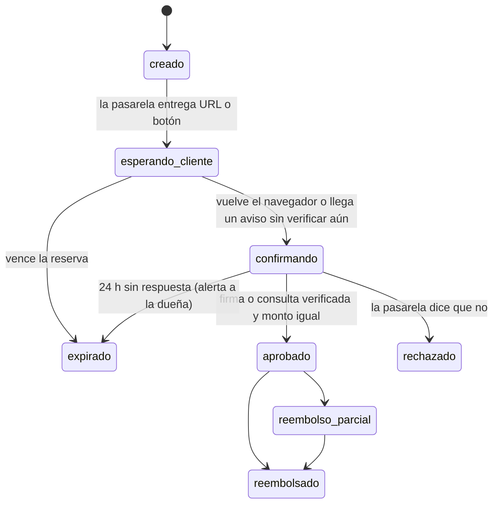

# 04 · Pagos en la web

## 1. Reglas (de Nébula, `docs/PAGOS-PANAMA.md`, y del CRM)

1. Ningún dato de tarjeta pasa por nuestros servidores: páginas o botones alojados por la pasarela.
2. El monto lo calcula el servidor; el navegador solo dice qué pedido y qué tipo de pago (abono o
   total).
3. Un pago se aprueba solo si el servidor lo verifica con la pasarela (aviso firmado o consulta), y
   si el monto confirmado es igual al esperado.
4. Cada aviso de pasarela se procesa una sola vez: `UNIQUE (proveedor, evento_id)`.
5. Moneda USD, sin conversión.
6. **Nunca se da por confirmado un pago que no se verificó** (regla del bot en la KB del CRM): el
   pago manual con comprobante lo confirma siempre una persona.
7. Una pasarela caída no deja a la clienta sin comprar: el pago manual por Yappy Comercial con
   comprobante siempre está disponible.

## 2. Qué método para qué

| Método | Proveedor | Abono | Total | Por qué |
|---|---|---|---|---|
| Yappy (botón en la web) | `yappy` | Sí | Sí | El más usado en Panamá, la comisión publicada más baja y la cuenta Yappy Comercial ya existe |
| Tarjeta de crédito o débito, cuotas BAC | `tilopay` | No | Sí | El cargo fijo publicado (~$0.35) ya es casi el 7 % de un abono de $5 |
| PayPal | `paypal` | No | Sí | La comisión más alta; sirve para quien paga desde fuera |
| Yappy Comercial, transferencia, Nequi, efectivo con comprobante | `manual` | Sí | Sí | El flujo de hoy; plan B si una pasarela se cae |
| Envío al interior (Ferguson) | cualquiera | No | Sí | La KB del CRM: «se paga la totalidad antes» |

Los métodos permitidos para abono viven en `ajustes.metodos_para_abono`. Confirmado el 2026-10-29
(D-14): el abono, solo con Yappy (y el pago manual); el total, con las tres pasarelas.

## 3. Estados del pago

Al pasar a `aprobado`, en un solo batch: el pago, `pedidos.pagado_cents`, `estado_pago`, la
transición a `agendado` si alcanza el abono, el asiento contable, el evento `pago.confirmado` y el
`meta.purchase` en el outbox, y la fila de control de la transición.

## 4. Por pasarela

### 4.1 Yappy · Botón de Pago (integración nueva)

Yappy retiró la versión vieja del botón y ahora se integra por API, con documentación oficial para
desarrolladores y ejemplos en Node.js
([Yappy, nueva integración](https://www.yappy.com.pa/comercial/desarrolladores/boton-de-pago-yappy-nueva-integracion/);
[actualización del botón](https://www.yappy.com.pa/comercial/actualizacion-del-boton-de-pago-yappy/)).

- **Credenciales:** ID de comercio y clave secreta, generadas en Yappy Comercial › Productos ›
  Botón de Pago por un usuario administrador. No son las mismas de la «Integración Core» (que solo
  lee movimientos): ver `tommalopty/docs/YAPPY.md`, «Yappy, los dos».
- **Forma:** un componente del navegador cargado desde Yappy + dos piezas en el servidor: una que
  crea la orden y otra que recibe la notificación del pago, verificada con la clave secreta.
- **Por confirmar al construir (F4):** nombres exactos de los endpoints, el algoritmo del hash de
  la notificación, los estados y el entorno de pruebas. Esta sesión no pudo abrir
  `yappy.com.pa` (la red del entorno lo bloquea); la tarea F4.6.1 es leer la documentación oficial y
  escribir `docs/YAPPY-BOTON.md` antes de programar. No se escribe código con nombres adivinados.
- **Comisión publicada:** 1 % + ITBMS por cobro, mínimo $0.02, según guías de terceros
  ([guía](https://catalyxstudio.com/guias/yappy-en-tu-pagina-web)). Se confirma con Yappy.
- **Adaptador:** `sistema/src/pagos/yappy.ts`, sobre la interfaz `PaymentProvider` de Nébula
  (`createPayment`, `verifyWebhook`, `refundPayment`), más `consultar()` para el conciliador si la
  API lo ofrece.

### 4.2 Tilopay · tarjetas y cuotas

- **API de página de pago alojada:** `processPayment` devuelve la URL del formulario; la clienta paga
  en Tilopay y vuelve a nuestra `redirect` (GET) con `code`, `order`, `tpt` y `OrderHash`; `code = 1`
  es aprobado ([processPayment](https://tilopay.com/en/developers/api/hosted-payment-page/process-payment)).
- **La verdad es la consulta.** El algoritmo de `OrderHash` no es público (se pide a
  soporte@tilopay.com) y la documentación de esta API no trae webhook. El servidor llama a `consult`
  con el número de orden y aprueba según lo que responda, monto incluido
  ([consult](https://tilopay.com/en/developers/api/procesos-operativos/consult)). El hash se valida
  además cuando soporte entregue el algoritmo.
- **Alternativa a evaluar en F4:** los enlaces de pago de Tilopay sí aceptan `webhook_url`
  ([crear enlace](https://tilopay.com/en/developers/api/links-de-pago/create-link-payment)). Si su
  experiencia en el teléfono es buena, un enlace por pedido da aviso por webhook y consulta como
  respaldo.
- **No se usa** la vía servidor a servidor: exige certificación PCI del comercio
  ([server-to-server](https://tilopay.com/en/developers/server-to-server)).
- **Comisión publicada:** su web muestra 3.75 % + $0.35 en tarjetas; Yappy por Tilopay, 2 % total
  ([Tilopay y Yappy](https://tilopay.com/yappy)). Se confirma en su página de tarifas y en el
  contrato.
- **Adaptador:** `sistema/src/pagos/tilopay.ts`.

### 4.3 PayPal

- **API Orders v2:** el servidor crea la orden (`POST /v2/checkout/orders`, `intent: CAPTURE`) con el
  monto del pedido; la clienta aprueba con los botones de PayPal; el servidor captura
  (`POST /v2/checkout/orders/{id}/capture`).
- **Webhooks:** `PAYMENT.CAPTURE.COMPLETED`, `PAYMENT.CAPTURE.REFUNDED`, `PAYMENT.CAPTURE.REVERSED` y
  `CUSTOMER.DISPUTE.CREATED`, verificados con `POST /v1/notifications/verify-webhook-signature` y el
  `PAYPAL_WEBHOOK_ID` de la app.
- **Reembolso:** `POST /v2/payments/captures/{capture_id}/refund`.
- **Comisión:** la tabla regional de PayPal que incluye a Panamá va de 5.40 % (hasta $3,000 al mes)
  a 4.70 % más un cargo fijo ([tarifas regionales](https://www.paypalobjects.com/marketing/ua/OA/merchant-fees/es-ROW-102826.pdf)).
  El retiro a un banco panameño va por MetroBank
  ([PayPal y MetroBank](https://panamaamerica.com.pa/economia/empresas-panamenas-podran-integrarse-la-plataforma-de-paypal-1200697)).
- **Adaptador:** `sistema/src/pagos/paypal.ts` (OAuth `client_credentials`, token en caché hasta su
  vencimiento).

### 4.4 Manual · comprobante

El flujo de hoy, ahora con registro:

1. La clienta manda el comprobante por el chat. El CRM llama a
   `registrarComprobante()`: la foto va a R2 privado y el sistema propone a qué pedido corresponde
   (pedido abierto de esa clienta con saldo).
2. A la dueña le llega por Telegram: foto + «¿Abono de $X al pedido BC-000123?» con ✅ / ✏️ / ❌.
3. Al confirmar, `confirmarAbono()` registra un pago `manual` aprobado por esa persona. El bot
   nunca lo confirma solo.
4. La conciliación del mes (F5) cruza estos pagos con el extracto de Yappy Comercial o del banco.

## 5. Reservas y vencimientos

- Al crear un pedido web se reservan las cajas en la bodega de la zona (fila en `reservas` y
  `existencias.reservado` en el mismo batch; el `CHECK (reservado <= fisico)` impide vender de más).
- Vencimiento: `ajustes.reserva_minutos_pago_en_linea` mientras paga en línea y
  `ajustes.reserva_horas_comprobante` si eligió pago manual (valores PENDIENTE de la dueña; la KB dice
  que el abono es lo que aparta).
- Cron cada 15 minutos: los pedidos `por_abonar` vencidos pasan a `cancelado`, se liberan sus
  reservas y, si tenían un pago en `esperando_cliente` o `confirmando`, se consulta antes a la
  pasarela (un pago que llega tarde reabre el pedido si todavía hay stock; si no, se reembolsa y se
  avisa a la dueña).
- Al pasar a `agendado` la reserva deja de vencer (`vence_en = NULL`).

## 6. El conciliador de pagos

Cron cada 10 minutos (`*/10 * * * *`):

1. Pagos en `esperando_cliente` o `confirmando` con más de 15 minutos → encola `pago.consultar`.
2. El consumidor consulta a la pasarela (`consult` de Tilopay, `GET /v2/checkout/orders/{id}` de
   PayPal, lo que ofrezca Yappy) y aplica el resultado con las mismas reglas que un aviso.
3. Más de 24 h sin respuesta → `expirado` y `sistema.alerta` a la dueña con el número de orden para
   revisarlo en el portal de la pasarela.
4. Cada consulta queda en `eventos_pasarela` con `evento_id = 'consulta:' + intento_ref + ':' + hora`.

## 7. Reembolsos y contracargos

| Caso | Qué pasa | Quién |
|---|---|---|
| Pedido cancelado con abono | Según `ajustes.cancelacion_con_abono`: reembolso o crédito para otro pedido | La dueña confirma |
| Reembolso por pasarela | `refundPayment()` del adaptador; el pago pasa a `reembolsado` o `reembolso_parcial` | Acción sensible del panel o del asistente |
| Reembolso manual (Yappy Comercial, efectivo) | Registro con comprobante; mismo asiento | La dueña |
| Devolución de producto | Movimiento `devolucion` (vuelve o no al inventario, como `/devolucion` del CRM) + reembolso o crédito | La dueña |
| Contracargo de tarjeta (Tilopay) o disputa (PayPal) | Se registra el contracargo, el pago queda marcado y se genera el asiento; aviso a la dueña | Por webhook de PayPal; a mano para Tilopay |
| Pago duplicado (pagó dos veces) | El segundo pago queda `aprobado` sin pedido abierto: alerta y reembolso | La dueña |

Los asientos de cada caso están en [05 §3](05-contabilidad.md#3-asientos-automáticos).

## 8. Comisiones y liquidaciones

- Al aprobar un pago se estima su comisión con `ajustes.comisiones` (porcentaje, fijo y si lleva
  ITBMS) y se registra contra «Por liquidar».
- Tilopay y PayPal depositan neto y en otra fecha. Al llegar el depósito (extracto del banco o
  reporte de la pasarela) se crea la `liquidacion` con sus pagos; la diferencia entre comisión
  estimada y real se ajusta en ese asiento.
- Yappy Comercial acredita en la cuenta de Banco General; la comisión se toma del extracto.

## 9. Lo que hay que pedir, y cuándo

Todo arranca en F0 porque tarda más que el código. Ninguna pasarela aprueba un comercio sin dominio
propio y sin las páginas legales publicadas (F1). El negocio está en regla (registro, cuenta
bancaria y Yappy Comercial a su nombre, confirmado el 2026-10-29): los trámites pueden empezar ya.

| Pasarela | Qué pedir | Quién | Bloquea |
|---|---|---|---|
| Yappy Botón de Pago | Activar el producto en Yappy Comercial y generar ID de comercio y clave; registrar el dominio | La dueña (usuario administrador de Yappy Comercial) | F4.6 |
| Tilopay | Afiliación en línea: datos del negocio, cuenta bancaria, sitio publicado con políticas | La dueña | F4.7 |
| Tilopay | Algoritmo de `OrderHash` (soporte@tilopay.com) | Quien programa, con la cuenta de la dueña | F4.7 (no bloquea: la consulta basta) |
| PayPal | Cuenta PayPal Business, app REST (client id, secret) y webhook | La dueña crea la cuenta; quien programa la app | F4.8 |
| Todas | Páginas de términos, privacidad, cambios y devoluciones, envíos | La dueña aprueba el texto | F1.7 |
| Red de las sesiones de Claude | Permitir `tilopay.com` y `yappy.com.pa` en la configuración de red del entorno | Quien administra el entorno | F4 |

## 10. Pruebas y salida a producción

- Cada adaptador tiene pruebas unitarias con respuestas grabadas (firmas válidas, inválidas,
  repetidas, montos distintos, estados raros).
- En staging, cada pasarela en modo de pruebas con E2E de Playwright: pedido → pago → aviso o
  consulta → pedido agendado → asiento.
- Antes de encender cada pasarela en producción: un cobro real de $1 y su reembolso, revisados en el
  portal de la pasarela y en el panel. Recién entonces entra en `ajustes.pasarelas_activas`.
- El interruptor apaga una pasarela al instante desde el panel; el checkout deja de ofrecerla.
