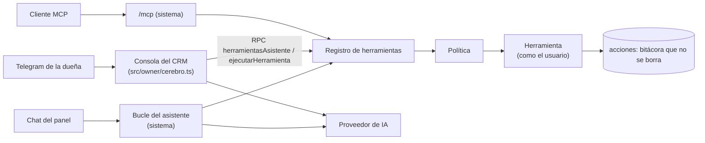

# 06 · El asistente del negocio

Nombre público: **PENDIENTE** (Brian es de D'Casa). En este documento, «el asistente».

## 1. Qué es

El equivalente de Brian (`D_Casa_new_word/docs/BRIAN.md`) para Baby Caleb: conversa en español con
el equipo, consulta todo (ventas, stock, pedidos, dinero, clientas) y hace cosas dentro de reglas
claras. Un solo catálogo de herramientas, tres puertas: el chat del panel, Telegram (la consola que
la dueña ya usa en el CRM) y MCP.

No atiende clientas: eso sigue siendo el bot del CRM.

## 2. Arquitectura



- **Registro** (`sistema/src/asistente/registro.ts`): cada herramienta declara `nombre` (verbo +
  objeto, en español), `descripcion` (1–2 frases con un ejemplo), `parametros` (zod → JSON Schema,
  con `additionalProperties: false`), `nivel`, `categoria`, `roles` y `ejecutar(ctx, args)`. Es el
  contrato de `dcasa_brian/models/registro.py` traducido a TypeScript.
- **Política** (`politica.ts`): lo prohibido no es una herramienta; además, la política revisa
  cada llamada (rol, nivel, adjuntos, texto externo, tamaño de argumentos) antes de ejecutar.
- **Bitácora** (`acciones`): cada ejecución con usuario, canal, argumentos, resultado, estado y si
  hubo adjuntos. No se edita ni se borra.
- **Proveedor de IA**: Meta Muse Spark Contributor (decisión D-19, §6), por la puerta de Meta
  compatible con el formato de Anthropic, detrás de una interfaz de proveedor como la del CRM
  (`src/llm/provider.ts`) para poder cambiar de modelo o de proveedor sin tocar el bucle.
- **Dónde corre el bucle**: en el panel y en MCP, en el sistema. En Telegram, en el CRM (es quien
  recibe el mensaje y ya tiene memoria de la conversación y herramientas propias como pausar o
  devolver al bot); pide las definiciones y ejecuta en el sistema por RPC, igual que Juan pide las
  herramientas a Odoo. La política y la bitácora siempre son las del sistema.

## 3. Niveles y política

| Nivel | Ejemplos | Comportamiento |
|---|---|---|
| lectura | resumen del día, ventas, quién debe, stock, reponer | Directo |
| construcción | crear pedido en borrador, registrar gasto, registrar compra en borrador, asignar motorizado, anotar | Directo y auditado |
| sensible | confirmar abono, registrar cobro, cambiar precio, ajustar stock, anular pedido, reembolsar, recibir compra, registrar merma, cerrar el mes, cambiar un ajuste | Propone con el detalle exacto; la persona toca **Permitir** o **Rechazar** |

**Lo que el asistente nunca hace** (no existe herramienta para eso):

1. Borrar o editar asientos, movimientos de inventario, pagos o la bitácora.
2. Cambiar roles o permisos, ni los suyos ni los de la dueña.
3. Ver o cambiar secretos, credenciales o claves.
4. Ejecutar SQL o código.
5. Actuar con más permisos que la persona con quien habla.
6. Escribirle a una clienta sin que la persona lo confirme (eso ya es regla de la consola del CRM).
7. Inventar una cifra: todo número sale de una herramienta.

**Confirmaciones.** Una acción sensible crea una fila `acciones` en estado `por_confirmar` con un
resumen legible y vence a los 30 minutos. En el panel es una tarjeta; en Telegram, botones con
`callback_data = id de la acción + HMAC` (como los botones que ya usa la consola del CRM). Solo la
misma persona puede confirmarla, y confirmar dos veces no la ejecuta dos veces (la idempotencia es
el id de la acción).

## 4. Canales

| Canal | Autenticación | Notas |
|---|---|---|
| Chat del panel | Access (JWT validado) | Botón flotante en todas las pantallas; sabe en qué pantalla está; pasos a la vista por SSE |
| Telegram | El vínculo de la consola del CRM (`OWNER_TELEGRAM_CHAT_ID` o enlace del panel) cruzado con `usuarios.telegram_chat_id` | Voz y fotos ya las entiende la consola |
| MCP | `/mcp` fuera de Access, con OAuth (`@cloudflare/workers-oauth-provider`) usando el inicio de sesión de Access, o un token personal por usuario | Se decide en F6.4; empieza solo con herramientas de lectura |

## 5. Herramientas iniciales

| Herramienta | Nivel | Roles |
|---|---|---|
| `resumen_del_dia` | lectura | todos |
| `ventas_del_periodo(desde?, hasta?, por?)` | lectura | dueña, contadora |
| `quien_me_debe` | lectura | dueña, contadora |
| `pedidos_de_hoy` · `buscar_pedido(numero o clienta)` | lectura | todos |
| `buscar_cliente` · `historial_de_cliente` | lectura | dueña, asistente |
| `ver_stock(codigo?)` · `movimientos(codigo?)` | lectura | todos |
| `que_reponer(proveedor?, meses?, reserva?)` | lectura | dueña |
| `dinero_en_cuentas` · `estado_de_resultados` · `gastos_del_periodo` | lectura | dueña, contadora |
| `margen_por_producto` · `ventas_por_canal` · `costo_por_clienta_nueva` | lectura | dueña |
| `entregas_del_dia` · `pagos_por_confirmar` | lectura | dueña, asistente |
| `clientas_para_recompra` | lectura | dueña |
| `crear_pedido` (queda por_abonar) | construcción | dueña, asistente |
| `crear_cotizacion` (no aparta nada) · `confirmar_cotizacion` (aquí sí aparta) | construcción | dueña, asistente |
| `ver_checkout` (si la web puede cobrar y qué falta) | lectura | dueña, asistente |
| `anotar_en_pedido` · `anotar_en_cliente` | construcción | dueña, asistente |
| `registrar_gasto` (con foto del recibo) | construcción | dueña, asistente |
| `registrar_compra` (borrador) · `poner_tiempo_de_llegada` | construcción | dueña |
| `asignar_motorizado` · `programar_entrega` | construcción | dueña, asistente |
| `confirmar_abono` · `registrar_cobro` | sensible | dueña |
| `cambiar_precio` · `ajustar_stock` · `registrar_merma` · `trasladar_stock` | sensible | dueña |
| `recibir_compra` | sensible | dueña |
| `anular_pedido` · `reembolsar` | sensible | dueña |
| `cerrar_mes` (guiado con la lista de chequeo) | sensible | dueña |
| `cambiar_ajuste` (abono mínimo, pasarela activa…) | sensible | dueña |

Una herramienta nueva solo entra con su prueba y con su fila en esta tabla.

## 6. Modelo, costo y caché

**Decidido el 2026-10-29 (D-19): Meta Muse Spark Contributor** (`muse-spark-1.2-contributor`),
sabiendo que Meta usa lo que recibe para entrenar sus modelos. La decisión es solo para el
asistente interno: el bot de clientas del CRM sigue con el modelo que tiene.

| Modelo | ID | Entrada / salida por millón | ¿Meta entrena con lo que recibe? | Costo estimado al mes | Papel |
|---|---|---|---|---|---|
| Muse Spark Contributor | `muse-spark-1.2-contributor` | ≈ $0.10 / $0.20 | Sí | ≈ $1.5–3 | El del asistente |
| Muse Spark 1.3 | `muse-spark-1.3` | $1.25 / $4.25 | No | ≈ $25–30 | Respaldo posible (misma llave) |
| Claude Haiku 5.5 | `claude-haiku-5-5` | $0.10 / $0.50 | — | ≈ $2–3 | Respaldo posible si Meta cae entera |

Precios de Meta: los de `CRM-Baby-Caleb/src/pricing.ts` (sep-2026). D'Casa dejó escrito que no los
pudo verificar en la página oficial (`JUAN_WORKER.md`): se confirman con la primera factura y, si un
modelo no tiene precio cargado, el tope lo cuenta con la tarifa más cara conocida. Supuestos del
costo: 30 consultas al día, 2.5 llamadas por consulta, ~8.000 tokens de entrada y ~600 de salida por
llamada, sin caché.

**Cómo se habla con Meta.** ⚠️ Lo de abajo se escribió como «lo que el CRM ya
aprendió en `src/llm/provider.ts`». Al implementar F2.7 (2026-11-09) se
comprobó que **en el CRM no hay nada de Meta**: su proveedor es
Anthropic/OpenAI/xAI. Estos cinco puntos no están verificados contra código que
exista, y la ruta exacta tampoco está confirmada. Lo que sí se verificó —que el
nivel Contributor existe, su precio y que se elige por el id del modelo— y qué
se hizo al respecto está en la corrección del 2026-11-09 de
`10-riesgos-y-decisiones.md`. Léala antes de tocar `proveedor.ts`.

- La API de Meta habla el formato de mensajes de Anthropic en `https://api.meta.ai/v1/messages`:
  mismo cliente, base explícita. Nunca `ANTHROPIC_BASE_URL` en el Worker (regla del CRM).
- La llave es `META_API_KEY` (o `MODEL_API_KEY`). **No** es el token de Messenger ni de Instagram,
  que jamás se manda a `api.meta.ai` (el CRM tiene una prueba que lo vigila; se copia).
- Sin `eager_input_streaming` en las herramientas: con ese campo, Meta falla en cada mensaje
  (`toolStreaming: false` en el CRM).
- `max_tokens` de 16 o más: Meta rechaza menos.
- Sin `cache_control`: no se sabe que Meta lo acepte. El costo se calcula sin caché.
- `tool_choice` en `auto`, y los argumentos de toda herramienta se validan con zod en el servidor
  antes de ejecutarla (no se cuenta con validación estricta del lado del modelo).
- El modelo está en `ajustes.modelo_asistente` y el de respaldo en `ajustes.modelo_respaldo`
  (PENDIENTE). Si el modelo falla dos veces seguidas, se usa el respaldo y queda anotado; sin
  respaldo, el asistente dice que no puede contestar ahora. Cambiar de modelo no exige desplegar.

**Herramientas en orden fijo.** Se mandan todas, siempre en el mismo orden. Con este modelo,
~6.000 tokens de herramientas cuestan ≈ $0.0006 por llamada: preseleccionar no ahorra nada que
importe, y una lista fija da respuestas más predecibles y deja lista la caché si un día se cambia a
un modelo que la tenga. La fecha, la hora y la pantalla actual van en el mensaje del turno, no en
las instrucciones.

**Tope mensual:** `ajustes.tope_ia_mensual_usd`, PENDIENTE. Propuesta: $10 al mes en total (unas
cuatro veces el gasto esperado), como red ante una llave filtrada o un bucle.

## 7. Defensas

Copiadas de Brian, que ya pasaron auditorías:

- Contenido de adjuntos, mensajes de clientas, notas y descripciones va marcado como **dato**; las
  marcas de bloque y etiquetas tipo `</system>` escritas dentro se neutralizan.
- Si alguno de los últimos 6 mensajes de la persona trae un archivo, toda herramienta de
  construcción pide confirmación como si fuera sensible.
- Si en el turno se usó una herramienta que lee texto escrito por clientas (`texto_externo`), las
  de construcción también piden confirmación.
- Tope de argumentos: 10.000 letras por dato y 30.000 por llamada, revisado antes de registrar.
- Tope de mensaje: 8.000 letras y 5 archivos.
- Tope de pasos por turno (8) y de mensajes por minuto por persona.
- **Tope de gasto mensual** global y por persona, en dólares, contado en `asistente_uso` con la
  tarifa de cada modelo (un modelo sin tarifa se cuenta con la más cara conocida). Al llegar, el
  asistente lo dice y no llama al modelo. La consola del CRM reporta su consumo con
  `registrarUsoIA` para que el tope sea uno solo.
- Telegram: solo los chats de `usuarios` activos; de cualquier otro, ninguna respuesta.
- **Datos de clientas fuera de lo que ve el modelo** (D-20). Meta entrena con lo que recibe el
  Contributor, y las clientas son terceras personas: lo que el asistente le manda al modelo no lleva
  nombres, celulares, correos, direcciones, coordenadas ni fotos de comprobantes. Cada clienta va
  como una referencia (`C-0042`) y el panel o Telegram ponen el nombre **después** de la respuesta
  del modelo, al mostrarla. Si la persona escribe un nombre («¿cuánto me debe Ana?»), la
  herramienta `buscar_cliente` lo resuelve en el servidor y al modelo le vuelve solo la referencia.
  Las cifras del negocio (ventas, costos, márgenes, stock) sí van: el dueño del proyecto lo aceptó.
  Es la prudencia que la auditoría de D'Casa pidió para los modelos `-contributor`
  (`JUAN_WORKER.md`), aplicada solo a datos de terceros. Se activa con `ajustes.ia_entrena_con_datos`
  y tiene su prueba: ningún resultado de herramienta que sale hacia el modelo contiene un celular,
  un correo o un nombre de `clientes`.

## 8. Datos

```sql
CREATE TABLE asistente_conversaciones (id TEXT PRIMARY KEY, usuario_id TEXT NOT NULL REFERENCES usuarios(id),
  canal TEXT NOT NULL CHECK (canal IN ('panel','telegram','mcp')), titulo TEXT,
  creado_en INTEGER NOT NULL, ultima_en INTEGER NOT NULL) STRICT;

CREATE TABLE asistente_mensajes (id TEXT PRIMARY KEY, conversacion_id TEXT NOT NULL
  REFERENCES asistente_conversaciones(id) ON DELETE CASCADE,
  rol TEXT NOT NULL CHECK (rol IN ('user','assistant','tool')), contenido_json TEXT NOT NULL,
  adjuntos_json TEXT, creado_en INTEGER NOT NULL) STRICT;

CREATE TABLE acciones (id TEXT PRIMARY KEY, herramienta TEXT NOT NULL, nivel TEXT NOT NULL,
  categoria TEXT, canal TEXT NOT NULL, usuario_id TEXT NOT NULL,
  conversacion_id TEXT,            -- queda aunque se borre la conversación (ON DELETE no se usa aquí)
  argumentos_json TEXT NOT NULL, resultado_json TEXT, error TEXT, resumen TEXT,
  estado TEXT NOT NULL CHECK (estado IN ('hecha','error','bloqueada','por_confirmar','rechazada','vencida')),
  con_adjuntos INTEGER NOT NULL DEFAULT 0, texto_externo INTEGER NOT NULL DEFAULT 0,
  creado_en INTEGER NOT NULL, cerrada_en INTEGER) STRICT;
-- Trigger: solo se permite UPDATE de estado/resultado/cerrada_en mientras estado = 'por_confirmar'; DELETE nunca.

CREATE TABLE asistente_uso (id TEXT PRIMARY KEY, usuario_id TEXT NOT NULL, canal TEXT NOT NULL,
  modelo TEXT NOT NULL, entrada INTEGER NOT NULL, salida INTEGER NOT NULL, cache_leida INTEGER NOT NULL,
  cache_escrita INTEGER NOT NULL, costo_micro_usd INTEGER NOT NULL, mes TEXT NOT NULL, creado_en INTEGER NOT NULL) STRICT;
```

Retención: conversaciones sin actividad por más de 180 días se borran (como Brian); `acciones` se
conserva siempre.

## 9. Pruebas y evaluaciones

- Proveedor «guion fijo» para pruebas: respuestas y llamadas a herramientas predefinidas, sin red.
- Cada herramienta: prueba de permisos por rol, de argumentos inválidos y de resultado.
- Pruebas de la política: adjuntos, texto externo, topes, confirmación vencida, doble confirmación.
- Evaluación con 30 preguntas reales de la dueña (por ejemplo «¿cuánto vendí esta semana y quién me
  debe?») con la herramienta esperada y el número correcto; se corre antes de cambiar de modelo o de
  prompt, y el cambio solo entra si no empeora.
