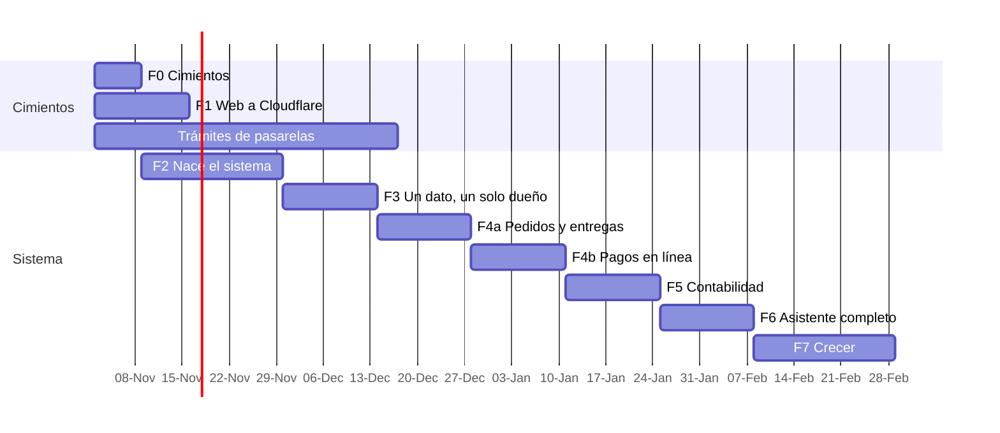

# 09 · Fases

Semanas de trabajo con sesiones de Claude y visto bueno de la dueña al cierre de cada fase. Incluye
~20 % de margen; los trámites de las pasarelas son la dependencia externa más lenta y por eso
arrancan en la semana 1. Fecha de arranque supuesta: lunes 2 de noviembre de 2026.

El asistente no espera a F6: su registro nace en F2 y cada fase le agrega las herramientas de lo
que construye. F6 abre los canales y lo pule.

---

## F0 · Cimientos (semana 1)

**Objetivo:** decidir lo que no se programa, empezar lo que tarda y dejar el repo listo.
**Depende de:** nada.

| ID | Tarea | Detalle |
|---|---|---|
| F0.1 | Comprar `babycaleb.com` | Cloudflare Registrar, cuenta de la agencia, titular Baby Caleb. Activar Email Routing (`hola@`) |
| F0.2 | Arrancar trámites de pago | Yappy Botón de Pago (credenciales), afiliación a Tilopay, cuenta PayPal Business. Lista en [04 §9](04-pagos.md#9-lo-que-hay-que-pedir-y-cuándo) |
| F0.3 | Respuestas pendientes | Las de [10 §3](10-riesgos-y-decisiones.md#3-preguntas-abiertas). Las que frenaban pagos (P1, P2) ya están respondidas: F0.2 arranca de inmediato |
| F0.4 | Conector de Cloudflare e inventario en vivo | Workers, D1, Vectorize, colas, plan, gasto del mes; confirmar que el plan es Workers Paid |
| F0.5 | Red de las sesiones | Permitir `tilopay.com` y `yappy.com.pa` en la configuración de red del entorno de Claude |
| F0.6 | Documentos vivos | `CLAUDE.md` ampliado, `docs/LEEME_PRIMERO.md`, `PRIORIDADES.md`, `CONTEXTO_AGENTICO.md`, `FUENTES_DE_VERDAD.md` |
| F0.7 | Limpieza sin tocar diseño | Borrar `bun.lock` (se queda npm), quitar `express`, `@google/genai`, `dotenv`, `metadata.json` y `server.js` del script `clean` si no se usan; `npm run build` igual |
| F0.8 | CI de la web | `web.yml` con lint, build y pruebas en cada PR |
| F0.9 | Alertas de presupuesto | $10 y $20 en Billing |

**Listo cuando:** dominio comprado, tres trámites en curso, CI en verde, documentos base en `main`.
**La dueña ve:** nada cambia.

---

## F1 · La web se muda a Cloudflare (semanas 1–2)

**Objetivo:** la misma web, píxel por píxel, en `babycaleb.com` desde Cloudflare, con lo que
piden las pasarelas y Meta.
**Depende de:** F0.1 (dominio).

| ID | Tarea | Detalle |
|---|---|---|
| F1.1 | Worker `babycaleb-web` | `wrangler.jsonc` de [01 §3](01-arquitectura.md#3-dominios-y-rutas); `worker/` con su `tsconfig` y tipos de Workers |
| F1.2 | `SITE_URL` en el build | Hoy sale de la variable `URL` de Netlify (`vite.config.ts`); sin ella el canónico, Open Graph y el sitemap salen sin dominio |
| F1.3 | Cabeceras | `public/_headers` con lo de `netlify.toml`; cabeceras en código para el HTML reescrito y `/api/*` |
| F1.4 | `/api/chat` | El mismo comportamiento de `netlify/functions/chat.ts` (Groq) dentro del Worker, para no romper nada; se reemplaza en F3.6 |
| F1.5 | `<head>` por ruta | `worker/head.ts` con `HTMLRewriter`: título, descripción, canónico, Open Graph y JSON-LD por página, sacados de `content.json`. `Seo.tsx` se queda para la navegación dentro de la SPA |
| F1.6 | Prueba de píxeles | Capturas de las 7 páginas en Netlify y en Cloudflare, computadora y teléfono, comparadas; diferencia 0 o explicada |
| F1.7 | Páginas legales | Términos, privacidad (Ley 81), cambios y devoluciones, envíos; con los bloques y tokens de la web; texto aprobado por la dueña |
| F1.8 | Analítica | Cloudflare Web Analytics |
| F1.9 | Corte de DNS | Runbook de [08 §7](08-operacion.md#7-runbooks); `www` → 301; Netlify vivo 2 semanas |
| F1.10 | Verificaciones de dominio | TXT de Meta y de Google Search Console; sitemap enviado |

**Pruebas:** del Worker (rutas, cabeceras, `<head>` por ruta), de humo con Playwright en la vista
previa, Lighthouse igual o mejor que Netlify.
**Listo cuando:** `babycaleb.com` sirve desde Cloudflare; capturas iguales; el depurador de enlaces
de Meta muestra título e imagen correctos por página; las páginas legales están publicadas.
**La dueña ve:** la misma web en su dominio. Hosting: $0.

---

## F2 · Nace el sistema (semanas 2–4)

**Objetivo:** el Worker, la base, el panel con la marca, la seguridad y los respaldos, todavía sin
datos reales.
**Depende de:** F0.4.

| ID | Tarea | Detalle |
|---|---|---|
| F2.1 | Esqueleto de `sistema/` | Hono, zod, `vitest-pool-workers`, `wrangler.jsonc` con D1, R2, colas, rate limits; entornos `staging` y producción |
| F2.2 | Migración 0001 | Catálogo, inventario, clientes, envíos (sin pedidos), sistema, controles; triggers de libros; prueba de que `STRICT`, triggers y llaves foráneas funcionan en D1 |
| F2.3 | Dominio puro | Portar de Nébula con sus pruebas: `money`, `stock`, `pricing`, `order-state`, `shipment-state`, `abonos`, `geo`, `direccion`, `rutas`, `asignacion`, `motorizado`, `csv` |
| F2.4 | Seguridad | `seguridad/access.ts` (portado de `edge/src/puerta.ts` de D'Casa), roles, `pin.ts`, `sesion.ts`, `turnstile.ts` |
| F2.5 | Outbox y colas | `eventos_salida`, publicador, consumidor de `bc-tareas`, colas muertas, `eventos_recibidos` |
| F2.6 | Panel | React + Vite + Tailwind 4 en `sistema/panel/`, tokens de `brand.json` (copiados con una prueba de que siguen iguales), reglas de teléfono del CRM; pantallas: inicio, catálogo, existencias, bodegas, zonas de envío, ajustes, usuarios |
| F2.7 | Registro del asistente | `registro.ts`, `politica.ts`, `acciones`, proveedor de guion fijo y proveedor Meta (con lo aprendido en el CRM); capa de referencias para datos de clientas; primeras herramientas de lectura (`ver_stock`, `movimientos`) |
| F2.8 | Salud | `/salud` con versión, migración y humo |
| F2.9 | Respaldos | `respaldo.yml` diario y simulacro semanal sobre staging |
| F2.10 | Contrato | `sistema/src/contrato/` con esquemas y huella; `docs/CONTRATO_CRM.md` |
| F2.11 | Flujo de despliegue | `sistema.yml` con staging y producción, `workers_dev = false` y `preview_urls = false` en producción, `panel.` y `ruta.babycaleb.com` |

**Pruebas:** migraciones desde cero; libros que no se editan; JWT de Access válido e inválido
(audiencia, firma, vencido, sin token); PIN y bloqueos; outbox con fallas de la cola; consultas por
pantalla.
**Listo cuando:** el panel abre en el teléfono detrás de Access con productos de prueba; workers.dev
de producción responde que no existe; el simulacro restaura; `/salud` sano en staging y producción.
**La dueña ve:** capturas del panel con su marca, para su visto bueno.

---

## F3 · Un dato, un solo dueño (semanas 4–6)

**Objetivo:** un solo catálogo para la web, el bot y el panel, y una sola voz en el chat.
**Depende de:** F2.

| ID | Tarea | Detalle |
|---|---|---|
| F3.1 | Carga inicial | Bodegas (`SUCURSALES` del CRM), productos y variantes con slug, peso y talla siguiente; zonas de envío desde `member/zonas-envio.ts` con alias |
| F3.2 | Entrypoints | `SistemaWeb` (catálogo, zonas) y `SistemaCRM` (catálogo, stock, venta, devolución, ajuste, deshacer, movimientos, cliente por identidad, cotizar envío) |
| F3.3 | Cambios en el CRM | `FuenteCatalogo` con interruptor `CATALOGO_FUENTE`, cliente RPC, contrato con huella; `catalogQuery`, ~~inventario de la consola~~ (ver nota ⚠️), pestaña Catálogo y `cotizarEnvio` usan la fuente; `auditar-verdad.ts` audita el sistema |
| F3.4 | Traspaso | Runbook de [08 §7](08-operacion.md#7-runbooks); omite `DESCATALOGADOS` de `test/babycaleb/verdad-del-cliente.ts` (hoy: solo `NAT-WIP` — ver nota ⚠️ abajo); movimiento `apertura` por bodega |
| F3.5 | La web lee el catálogo | `/api/catalogo` con caché de 60 s; `content.json` gana `codigo` y pierde `price`/`priceFrom`; copia de respaldo en el build; prueba que falla si vuelve un precio |
| F3.6 | Canal web del CRM | `CanalWeb` en el CRM; el widget de la web llama a `/api/chat` → `CRM.mensajeWeb()`; misma KB, revisor y trato de usted; se apaga Groq y se borra `netlify/functions/` |
| F3.7 | Fichas de producto | `/productos/:slug` con los bloques existentes y JSON-LD `Product` con precio del sistema |
| F3.8 | Herramientas del asistente | `cambiar_precio`, `ajustar_stock`, `trasladar_stock`, `registrar_merma` (sensibles) |

**Pruebas:** contrato en los dos repos; `test/babycaleb/` del CRM con las dos fuentes; búsquedas del
bot iguales antes y después (`busqueda-catalogo.test.ts`); prueba de la web contra precios en
`content.json`.
**Listo cuando:** cambiar un precio en el panel lo cambia en la web y en el bot sin publicar nada;
`pnpm auditar` del CRM pasa contra el sistema; el chat de la web habla de usted y crea tickets.
**La dueña ve:** su catálogo en el panel; la web y el bot dicen lo mismo.
**Riesgo:** romper la atención. Mitigación: interruptor, staging del CRM y ventana de traspaso.

> ⚠️ **Al hacer F3.3 (2026-11-10): «inventario de la consola» no tenía nada que
> convertir.** La consola de la dueña no existe todavía en el CRM — no hay
> `src/owner/`, no hay comandos de inventario, y [03 §Archivos](03-contratos.md)
> sitúa `src/owner/cerebro.ts` en **F6**. Así que ese punto no se omitió: no
> había código que apuntara a `catalog_items`. Cuando se construya la consola,
> nace leyendo de `fuenteDeCatalogo` y no hay nada que migrar.
>
> Lo que sí se decidió al hacerlo: la pestaña Catálogo **no** se queda como
> editor cuando el dueño del dato es el sistema. Pasa a solo lectura con un
> guardia que falla cerrado, porque leer de la fuente y seguir escribiendo en la
> D1 del CRM significa que la dueña ve «Guardado» y el bot sigue cotizando otro
> precio. Es el «interruptor del CRM en solo lectura» de
> [08 §Traspaso del catálogo](08-operacion.md).

> ⚠️ **Corrección del 2026-11-09 (al hacer F3.1).** Esta tabla decía que
> `DANY-AW1200` estaba descatalogado. No lo está: en
> `test/babycaleb/verdad-del-cliente.ts` la lista `DESCATALOGADOS` tiene solo
> `NAT-WIP`, y `DANY-AW1200` sigue en `PRODUCTOS` a $40, con su renombrado
> desde `DANY-AW2` en el seed del CRM. Manda el archivo de la verdad, que es la
> transcripción del documento de la dueña, así que la carga inicial lo trae
> ACTIVO. Si de verdad salió de circulación, hay que corregirlo primero en ese
> archivo —como dice el CLAUDE.md del CRM— y después aquí.

---

## F4a · Pedidos y entregas (semanas 6–8)

**Objetivo:** el pedido como registro propio, de la web o del chat hasta la puerta de la clienta,
con pago manual.
**Depende de:** F3.

| ID | Tarea | Detalle |
|---|---|---|
| F4.1 | Migración de pedidos y pagos | Tablas de [02 §6–7](02-datos.md#6-pedidos), `secuencias`, `idempotencia` |
| F4.2 | Crear pedido | Batch con secuencia, líneas, reservas (`CHECK`), evento y control; precio y envío del servidor; `requiere_pago_total` por zona |
| F4.3 | Carrito y «Hacer mi pedido» | En la web, con los bloques y tokens existentes, carga bajo demanda; Turnstile; consentimiento separado; página `/pedido/:token` |
| F4.4 | Pago manual | `registrarComprobante` y `confirmarAbono`; botones en Telegram; ajustes `metodos_para_abono`, reservas y vencimientos |
| F4.5 | Envíos | Asignación de bodega, motorizados, `ruta.babycaleb.com` (PIN), lista del día con orden sugerido (`proponerRuta` de Nébula), foto y cobro del saldo; guía 4×6 imprimible con QR a Waze y Google Maps; `/seguimiento/:token` |
| F4.6 | Mapa | PMTiles de Panamá en R2 (`mapas.babycaleb.com`), `maplibre-gl`, `/api/geo/*` |
| F4.7 | `/venta` crea pedidos | `registrarVenta` desde la consola con «¿ya pagó?» y bodega; `pedido.entregado` marca «compró» en el CRM |
| F4.8 | Avisos | `bc-avisos` y el consumidor del CRM; plantillas de utilidad de WhatsApp enviadas a aprobación en Meta |
| F4.9 | Herramientas | `crear_pedido`, `pedidos_de_hoy`, `buscar_pedido`, `entregas_del_dia`, `asignar_motorizado`, `confirmar_abono`, `anular_pedido` |

**Pruebas:** concurrencia (dos pedidos por la última caja: uno gana, el otro recibe `sin_stock`);
idempotencia (doble envío del formulario, doble toque); transiciones inválidas; vencimiento de
reservas; E2E web → comprobante → agendado → en ruta → entregado.
**Listo cuando:** un pedido real va del chat o de la web a entregado y cobrado sin hojas aparte.
**La dueña ve:** pedidos del día, quién debe, qué lleva cada motorizado.

---

## F4b · Pagos en línea (semanas 8–10)

**Objetivo:** cobrar en la web con Yappy, Tilopay y PayPal.
**Depende de:** F4a y las credenciales de F0.2 (si una no llegó, esa pasarela se corre sin bloquear
a las demás ni a F5).

| ID | Tarea | Detalle |
|---|---|---|
| F4.10 | Interfaz de pagos | `PaymentProvider` de Nébula + `consultar()`; `eventos_pasarela`; rutas `/api/pagos/*` |
| F4.11 | Yappy | Leer la documentación oficial y escribir `docs/YAPPY-BOTON.md`; adaptador; modo de pruebas; abono y total |
| F4.12 | Tilopay | `processPayment` + `consult`; evaluar enlaces de pago con webhook; `OrderHash` cuando soporte lo entregue; solo total |
| F4.13 | PayPal | Orders v2, captura, webhooks verificados, reembolso; solo total |
| F4.14 | Conciliador | Cron de [04 §6](04-pagos.md#6-el-conciliador-de-pagos) |
| F4.15 | Reembolsos y contracargos | Flujos de [04 §7](04-pagos.md#7-reembolsos-y-contracargos) |
| F4.16 | CSP final | Lista exacta de orígenes de cada proveedor |
| F4.17 | Salida a producción | Por pasarela: cobro real de $1 y reembolso; recién entonces entra en `pasarelas_activas` |

**Pruebas:** firmas válidas, inválidas y repetidas; monto distinto; aviso antes de la vuelta y
vuelta sin aviso; pago tardío sobre pedido vencido; E2E por pasarela en staging.
**Listo cuando:** las tres pasarelas cobran en producción (o las que tengan credenciales) y el
conciliador no deja pagos colgados.
**La dueña ve:** la clienta paga en la web y a ella le llega el aviso con el pedido ya agendado.

---

## F5 · Contabilidad gerencial (semanas 10–12)

**Objetivo:** saber cuánto entra, cuánto sale y cuánto se gana de verdad, y cerrar el mes.
**Depende de:** F4a (F4b no bloquea: las liquidaciones de pasarela entran cuando haya).

| ID | Tarea | Detalle |
|---|---|---|
| F5.1 | Migración contable | Cuentas, periodos, asientos, controles de cuadre, extractos ([02 §10](02-datos.md#10-contabilidad)) |
| F5.2 | Asientos automáticos | Los 18 de [05 §3](05-contabilidad.md#3-asientos-automáticos), cada uno con su prueba de cuadre |
| F5.3 | Arranque contable | Fecha de corte, conteo físico, costos de apertura con la contadora, saldos, asiento de apertura |
| F5.4 | Compras a proveedor | Borrador → confirmada → recibida con prorrateo de gastos; proveedores con tiempo de llegada |
| F5.5 | Gastos | Con foto del recibo; categorías del plan de cuentas |
| F5.6 | Caja del motorizado | Cobros, liquidación diaria, pago por viajes (regla PENDIENTE de la dueña) |
| F5.7 | Conciliación | CSV de Yappy Comercial y del banco; liquidaciones de Tilopay y PayPal |
| F5.8 | Reportes | Los de [05 §5](05-contabilidad.md#5-reportes) y Reponer |
| F5.9 | Cierre de mes | Lista de chequeo, bloqueo, Excel y ZIP para la contadora |
| F5.10 | Herramientas | `quien_me_debe`, `dinero_en_cuentas`, `estado_de_resultados`, `registrar_gasto`, `registrar_compra`, `recibir_compra`, `que_reponer`, `cerrar_mes` |
| F5.11 | Retiro del catálogo viejo | La D1 del CRM deja de tener `catalog_items` en uso; se exporta a R2 y se marca en el CRM |

**Pruebas:** cada asiento cuadra; periodo cerrado rechaza asientos; costo promedio con redondeos;
prorrateo; conciliación con CSV reales anonimizados; balance = 0 tras un mes simulado.
**Listo cuando:** el primer cierre de mes sale del panel y cuadra con el banco.
**La dueña ve:** cuánto ganó el mes, en una pantalla.

---

## F6 · El asistente completo (semanas 12–14)

**Objetivo:** el Brian de Baby Caleb en el panel, en Telegram y por MCP.
**Depende de:** F5 (las herramientas de dinero).

| ID | Tarea | Detalle |
|---|---|---|
| F6.1 | Catálogo completo | Las herramientas de [06 §5](06-asistente.md#5-herramientas-iniciales) con su prueba |
| F6.2 | Chat del panel | Botón flotante, contexto de pantalla, pasos en vivo por SSE, tarjetas Permitir/Rechazar |
| F6.3 | Telegram | **Hecho distinto (2026-11-12):** el webhook vive en el SISTEMA (`POST /telegram/webhook`, fuera de Access) y mueve el turno con `conversar(...)`, en vez de que el `cerebro.ts` del CRM pida las herramientas por RPC — ver la corrección de [06 §4](06-asistente.md#4-canales). Confirmaciones con botones y gasto anotado, sí. Queda sin memoria de conversación y sin host decidido |
| F6.4 | MCP | `/mcp` con OAuth o token personal; empieza con lectura |
| F6.5 | Modelo y tope | Muse Spark Contributor (D-19) con la capa de referencias (D-20) y su prueba; modelo de respaldo; tope mensual global y por persona |
| F6.6 | Defensas | Las de [06 §7](06-asistente.md#7-defensas) con sus pruebas |
| F6.7 | Evaluación | 30 preguntas reales con herramienta y cifra esperadas |

**Listo cuando:** «¿cuánto vendí esta semana y quién me debe?» se contesta igual en el panel y en
Telegram, con cifras que cuadran con el resumen; la evaluación pasa.
**La dueña ve:** le pide las cosas con sus palabras, por voz o con una foto.

---

## F7 · Crecer (semanas 14–17)

**Objetivo:** que la clienta vuelva sola y que Meta sepa quién compró.
**Depende de:** F4 y F6.

| ID | Tarea | Detalle |
|---|---|---|
| F7.1 | Mi cuenta | Código por plantilla de autenticación o PIN; pedidos, saldo, seguimiento, «Repetir mi pedido» |
| F7.2 | Recompra con talla siguiente | Con el peso del bebé y `siguiente_codigo`, el seguimiento del CRM sugiere la talla que viene |
| F7.3 | Socios | Puntos por compra pagada y referidos; cifras de la dueña en `reglas.json` + `ajustes`; libro que no se edita (reglas de Socios de D'Casa) |
| F7.4 | Meta | Píxel con `event_id`; `Purchase` por CAPI al pagarse un pedido (también los del chat), con hash y consentimiento; catálogo para anuncios desde `/api/catalogo` |
| F7.5 | Descuentos | Cupones con validación no enumerable (patrón `validate_discount` de Nébula) |
| F7.6 | Auditoría | Revisión a fondo por rondas, como D'Casa; lo que salga se arregla antes de seguir |

**Listo cuando:** las campañas optimizan con ventas reales y hay recompras que llegan sin que nadie
escriba.

---

## Qué ve la dueña al final de cada fase

Capturas con datos de prueba, en computadora y teléfono, antes de staging; su visto bueno antes de
producción (receta de D'Casa). Si el código cambia después de su «sí», se le avisa antes de unir a
`main`.
